# CÓC ĐI LÀM — KIẾN TRÚC HỆ THỐNG TRIỂN KHAI PRODUCTION HOÀN CHỈNH
*(Production Architecture Specification — Final Consistency Edition)*

---

## 0. Bối Cảnh Dự Án & Mục Tiêu Thiết Kế (Project Context & Design Goals)

### 0.1. Bối cảnh & Sứ mệnh (Theo Project Proposal)
- **Đơn vị nghiên cứu & phát triển:** Nhóm 1 (Nguyễn Nhật Huy, Ngô Nguyễn Khánh Huy, Nguyễn Xuân Thắng, Hoàng Nguyễn Việt) — ĐH FPT.
- **Đối tượng phục vụ:** Sinh viên chuẩn bị bước vào kỳ thực tập doanh nghiệp (OJT) và cử nhân mới tốt nghiệp (Fresher), ưu tiên trước mắt khối ngành Công nghệ thông tin (IT) và Kinh tế.
- **Thực trạng giải quyết:** Sinh viên nắm vững lý thuyết nhưng thiếu va chạm với các bài toán thực tiễn từ doanh nghiệp, dễ mất bình tĩnh, lúng túng, trả lời lan man khi phỏng vấn OJT chuyên sâu.
- **Sứ mệnh giải pháp:** Đóng vai trò một "Phòng Lab" khép kín đồng hành từ khâu rà soát tối ưu hồ sơ (CV) đến thực chiến phỏng vấn 1-1 bằng giọng nói thời gian thực với áp lực thời gian, cung cấp phản hồi chi tiết để sinh viên bịt kịp thời các lỗ hổng kiến thức trước khi bước vào phỏng vấn thật.

### 0.2. Các mục tiêu thiết kế cốt lõi (Core Invariants)
1. **Luồng thoại (Voice path):** Khi phiên đang ở **voice mode**, toàn bộ VAD/STT/TTS bắt buộc chạy **Edge AI** trực tiếp trên trình duyệt thông qua WebAssembly (WASM) / WebGPU / Web Workers, không đòi hỏi GPU rời. Nếu Edge audio không khả dụng, hệ thống **tắt voice mode và chuyển sang Local Degraded Text Mode**; tuyệt đối không chuyển raw audio sang Cloud để thay thế.
2. **Âm thanh thô (Raw audio):** Trong luồng phỏng vấn mặc định, raw microphone audio chỉ được xử lý cục bộ và không được gửi lên Backend. Nếu người dùng chủ động opt-in cho lưu trữ/huấn luyện, đó là **một data-flow riêng ngoài realtime interview path**, không được dùng làm fallback tự động.
3. **Laya đóng vai trò Control Plane System-1:** Đảm nhiệm phân loại (classification), định tuyến (routing), kiểm soát cổng (gating) và lựa chọn hành động trong **tập action tương ứng với từng giai đoạn** do Hard Policy Engine xác định (`allowed_stream_actions`, `allowed_asr_actions`, `allowed_turn_actions`). Laya **không có quyền tự đặt, thay đổi hoặc vượt qua policy**, và không bao giờ trực tiếp sinh văn bản câu hỏi thô.
4. **LLM không trực tiếp nắm giữ trạng thái phiên (session state)** và không có quyền tự ý sửa đổi trạng thái bền vững hay quyết định mọi hành vi trong luồng phỏng vấn.
5. **Thu thập dữ liệu (Crawl/search):** Không chạy trên máy client; toàn bộ được xử lý tập trung ở backend để cache và tái sử dụng cho nhiều sinh viên cùng ứng tuyển một vị trí/công ty.
6. **Chấm điểm & Nhận xét (Scoring/Feedback):** Mọi đánh giá và điểm số bắt buộc phải neo chặt vào **Verified Canonical Transcript** kèm structured evidence; raw audio hoặc transcript chưa xác minh không được ảnh hưởng tới scoring.
7. **Bất đồng nhận diện giọng nói cốt lõi (Critical ASR disagreement):** Tuyệt đối không được đoán mò hoặc tự ý suy diễn khi có sự sai lệch ở các từ khóa kỹ thuật.

---

## 1. Kiến Trúc Phân Hệ Nghiệp Vụ (Core Functional Modules)

Hệ thống được thiết kế thành **2 phân hệ nghiệp vụ tách biệt về workflow**, nhưng **dùng chung hồ sơ CV đã được nạp và phân tích như một dữ liệu tiên quyết (shared prerequisite)**. Sinh viên không bắt buộc phải hoàn thành Phân hệ 1 trước khi vào Phân hệ 2, nhưng **Phân hệ 2 bắt buộc phải có CV khả dụng**; nếu chưa có, giao diện Phỏng vấn sẽ yêu cầu tải CV và chạy bước phân tích hồ sơ tối thiểu trước khi khởi tạo phiên.

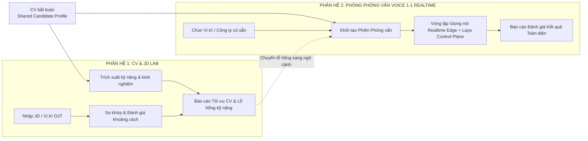

### Phân hệ 1: Phòng Lab Tối ưu CV theo chuẩn JD (CV & JD Lab)
- **Mục tiêu:** Giúp sinh viên rà soát, phát hiện thiếu sót và tối ưu hóa hồ sơ trước khi nộp cho nhà tuyển dụng OJT.
- **Hoạt động độc lập:** Sinh viên có thể chỉ sử dụng phân hệ này để sửa CV mà không bắt buộc phải bước vào phòng phỏng vấn.
- **Cầu nối sang Phân hệ 2:** Cho phép sinh viên bấm nút *"Bắt đầu phỏng vấn thử thách các điểm yếu này"* để tự động chuyển toàn bộ danh sách lỗ hổng kỹ năng (skill gaps) sang làm hạt giống tạo câu hỏi cho Phân hệ 2.

### Phân hệ 2: Phòng Giả lập Phỏng vấn 1-1 bằng Giọng nói (Realtime Voice Interview Room)
- **Mục tiêu:** Môi trường cọ xát thực chiến 1-1 bằng giọng nói theo thời gian thực dưới áp lực thời gian.
- **Điều kiện đầu vào:** Bắt buộc có CV đã được nạp và phân tích thành `Candidate Profile`. Nếu người dùng đi thẳng vào Phân hệ 2 mà chưa từng sử dụng Phân hệ 1, giao diện yêu cầu tải CV và chạy `Profile Service` tối thiểu; **không bắt buộc phải hoàn thành quy trình tối ưu CV/JD của Phân hệ 1**.
- **Tái sử dụng dữ liệu:** Nếu CV đã được xử lý ở Phân hệ 1, Phân hệ 2 dùng lại `Candidate Profile`, dự án, kỹ năng và skill gaps tương ứng thay vì yêu cầu tải lại.
- **Tính năng chuyên sâu:** Nhận diện giọng nói đa ngữ Việt - Anh, cơ chế chen ngang (barge-in), ngắt lời thông minh (soft-interrupt), chấm điểm theo bằng chứng và xuất báo cáo cải thiện chi tiết.

---

## 2. Phân Bổ Vị Trí Mô Hình & Ngăn Xếp Công Nghệ (Model Placement & Tech Stack)

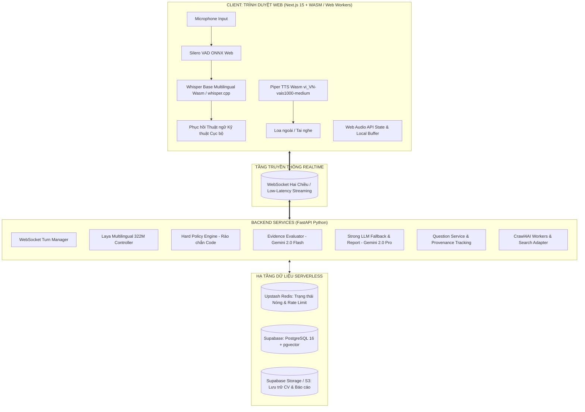

### 2.1. Tại Thiết Bị Đầu Cuối (Client Web Browser)
- **Framework nền tảng:** **Next.js 15 (App Router)**, React 19, TypeScript, Tailwind CSS.
- **VAD (Phát hiện hoạt động giọng nói):** `Silero VAD ONNX` chạy trong Web Worker thông qua ONNX Runtime Web.
- **STT (Chuyển giọng nói thành văn bản):** `Whisper Base Multilingual` lượng tử hóa (quantized) chạy qua WebAssembly (`whisper.cpp wasm` / Transformers.js), độ trễ thấp trên CPU thông thường.
- **Phục hồi thuật ngữ kỹ thuật (Technical-Term Recovery):** Từ điển kỹ thuật chuyên ngành kết hợp thuật toán so khớp âm vị ngữ cảnh (phonetic & context matcher) chạy trực tiếp tại client.
- **TTS (Tổng hợp tiếng nói):** `Piper TTS` biên dịch WebAssembly với giọng đọc tiếng Việt chất lượng cao checkpoint `vi_VN-vais1000-medium`.
- **Cơ chế âm thanh:** `Web Audio API` với AudioWorklet, đệm âm thanh vòng (ring buffer) cục bộ.

### 2.2. Tại Hệ Thống Máy Chủ (Backend Services)
- **Framework:** **FastAPI (Python 3.11+)**, kiến trúc bất đồng bộ (asyncio), quản lý kết nối streaming WebSocket.
- **Mặt phẳng điều khiển Laya (System-1 Control Plane):**
  - Checkpoint: **Laya Multilingual 322M** (trọng số huấn luyện chuyên sâu của nhóm).
  - Triển khai: Đóng gói thành controller độc lập (nạp trực tiếp qua PyTorch/ONNX Runtime hoặc microservice nội bộ).
- **Bộ đánh giá bằng chứng (Evidence Evaluator):** Sử dụng **Google Gemini 2.0 Flash API** với chế độ xuất dữ liệu cấu trúc (Structured Outputs / JSON Schema).
- **LLM dự phòng & Báo cáo chuyên sâu (Strong LLM Fallback):** Sử dụng **Google Gemini 2.0 Pro API** (hoặc GPT-4o / Claude 3.5 Sonnet) để suy luận ngữ nghĩa phức tạp và viết báo cáo tổng kết.
- **Điều phối & Cào dữ liệu (Data Orchestrator & Crawler):** `Crawl4AI workers` cào dữ liệu tuyển dụng/blog công nghệ kết hợp Gemini Flash tool-calling.

### 2.3. Hạ Tầng Dữ Liệu Không Máy Chủ (Serverless Data Layer)
- **Supabase (PostgreSQL 16 + pgvector):** Lưu trữ quan hệ bền vững (hồ sơ, câu hỏi, phiên phỏng vấn, bằng chứng) và tìm kiếm vector tương đồng ngữ nghĩa.
- **Upstash Redis:** Redis Serverless cho trạng thái phiên nóng (hot state), đếm chen ngang, rào chắn tốc độ (rate limiting) với độ trễ phản hồi < 10ms.
- **Supabase Storage / Object Storage:** Lưu trữ CV gốc dạng PDF và các tệp báo cáo hoàn chỉnh.


### 2.4. Chiến Lược Điều Phối Hybrid Edge - Cloud (Hybrid Edge-Cloud Orchestration Strategy)

Kiến trúc giữ nguyên nguyên tắc **voice path local-first**, đồng thời tách rõ hai loại điều phối để phần lớn mô hình nhỏ vẫn nằm tại thiết bị nhưng các tác vụ cần lập kế hoạch, truy cập Internet và tổng hợp tri thức có thể đưa lên Cloud:

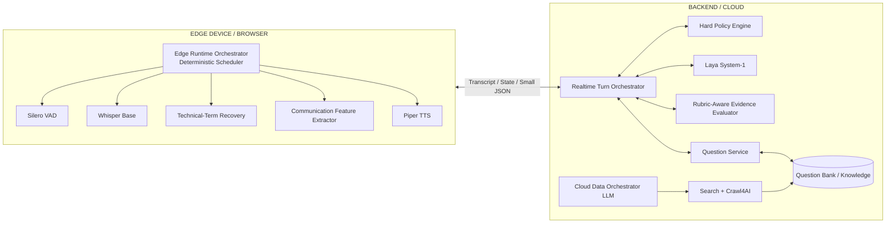

**A. Edge Runtime Orchestrator — không phải LLM sinh văn bản**
- Là bộ điều phối cục bộ bằng TypeScript/Web Worker/State Machine, chịu trách nhiệm bật/tắt và lên lịch các model nhỏ trên trình duyệt: VAD, STT, Technical-Term Recovery, Communication Feature Extractor và TTS.
- Không yêu cầu model lớn, không tự crawl Internet và không tự sinh câu hỏi.
- Có quyền thực hiện các hành vi có độ trễ cực thấp mà không cần round-trip Cloud, ví dụ: `speech_started`, `speech_ended`, dừng TTS khi barge-in, quản lý ring buffer, phát hiện audio quá nhỏ/rè và lưu partial transcript.
- **Phiên phỏng vấn yêu cầu kết nối Internet liên tục.** Khi mất kết nối tới backend, Edge Runtime Orchestrator chỉ được phép giữ trạng thái giao diện và buffer cục bộ ngắn hạn để phục vụ khôi phục phiên; **không được tiếp tục đặt câu hỏi, chấm điểm, điều chỉnh độ khó hoặc cập nhật memory ở chế độ offline**.

**B. Cloud Data Orchestrator — LLM có Tool Calling**
- Có thể triển khai hoàn toàn trên Cloud vì nhiệm vụ chính là lập kế hoạch search/crawl, kiểm tra độ mới của dữ liệu, chọn nguồn, gọi `Search Adapter`, `Crawl4AI`, bộ trích xuất và dịch vụ lưu trữ.
- Không nằm trong critical realtime audio path, do đó việc gọi Cloud không ảnh hưởng trực tiếp tới VAD/STT/TTS.
- Chỉ nhận các thuộc tính cần thiết như `company`, `role`, `JD`, yêu cầu làm mới tri thức và trạng thái cache; **không cần nhận raw microphone audio**.
- Orchestrator được phép đề xuất kế hoạch thu thập dữ liệu nhưng mọi URL, domain, giới hạn crawl, quyền ghi Question Bank và lịch refresh vẫn phải đi qua code policy.

**C. Phân bố model theo nguyên tắc Edge-first**
- **Thiết bị người dùng:** Silero VAD, Whisper Base Multilingual, Piper TTS, Technical-Term Recovery, các bộ trích xuất đặc trưng giao tiếp nhỏ/thuần thuật toán và các classifier ONNX rất nhỏ nếu được bổ sung sau benchmark.
- **Backend/Cloud:** Laya 322M, Hard Policy Engine, Evidence Evaluator, Strong LLM, Cloud Data Orchestrator và crawler. Laya **được chốt triển khai tại Server/Cloud**, chỉ nhận transcript/state/small JSON từ Edge và không nhận raw microphone audio.
- Mục tiêu là giữ **các model audio, latency-sensitive và privacy-sensitive trên device**, trong khi Laya và các model cần tool-use, reasoning lớn hoặc dữ liệu Internet được đặt trên Cloud để tránh làm nặng máy người dùng.


---

## 3. Tiền Phỏng Vấn & Xử Lý Tri Thức Dữ Liệu (Pre-interview / Data Intelligence Plane)

**Đầu vào:** CV ứng viên + Tên công ty + Vị trí ứng tuyển (Role) + **JD context**. `JD context` có thể do người dùng tải/nhập trực tiếp hoặc được hệ thống lấy từ `jobs/company_knowledge` đã cache cho role đã chọn; người dùng không bắt buộc phải tự cung cấp một file JD nếu hệ thống đã có JD hợp lệ.

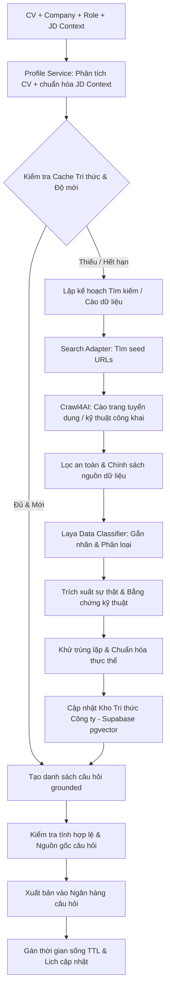

**Thứ tự ưu tiên nguồn dữ liệu (Source Priority):**
1. Bản mô tả công việc (JD) do người dùng hoặc doanh nghiệp trực tiếp cung cấp.
2. Trang tuyển dụng/nghề nghiệp chính thức của công ty (Official careers/jobs).
3. Blog kỹ thuật/sản phẩm chính thức của doanh nghiệp (Official engineering/product blog).
4. Tài liệu kỹ thuật chính thức (Official technical documentation).
5. Các nguồn báo chí, phân tích uy tín bên ngoài (Reputable external sources).
6. Báo cáo/kinh nghiệm phỏng vấn từ bên thứ ba (Third-party candidate reports) — *bắt buộc gắn nhãn `source_type: third_party`, không được giả mạo làm câu hỏi chính thức của công ty*.

> [!IMPORTANT]
> **Quy tắc vận hành:** Tuyệt đối không bao giờ làm gián đoạn (block) phiên phỏng vấn trực tiếp để chờ cào dữ liệu lớn. Quá trình phỏng vấn thời gian thực luôn sử dụng bộ nhớ đệm nóng (hot cache) kết hợp dự phòng từ Ngân hàng câu hỏi (Question Bank fallback).


### 3.1. Interview Experience Intelligence — Tự Thu Thập Kinh Nghiệm Phỏng Vấn Người Đi Trước

Bên cạnh tri thức chính thức từ doanh nghiệp, hệ thống duy trì một **Interview Experience Memory Base** chuyên lưu các trải nghiệm phỏng vấn đã được công khai hoặc do người dùng tự nguyện đóng góp. Kho này **tách biệt với Company Knowledge chính thức** để tránh biến lời kể của ứng viên thành sự thật được doanh nghiệp xác nhận.

#### 3.1.1. Nguồn thu thập

Cloud Data Orchestrator chủ động lập kế hoạch tìm kiếm theo bộ khóa:

```text
company
+ role
+ seniority
+ location
+ interview / OJT / intern / fresher
+ technical interview / HR / coding test / case study
```

Các nguồn có thể bao gồm:
- Bài chia sẻ kinh nghiệm phỏng vấn công khai trên blog cá nhân.
- Diễn đàn/cộng đồng nghề nghiệp công khai và các bài thảo luận có thể truy cập hợp lệ.
- Trang review/kinh nghiệm tuyển dụng công khai.
- Bài viết tổng hợp từ các nguồn báo chí/cộng đồng uy tín.
- Nội dung tuyển dụng chính thức có mô tả quy trình phỏng vấn.
- **User-contributed debrief:** sinh viên sử dụng hệ thống tự nguyện ghi lại trải nghiệm sau khi vừa hoàn thành một buổi phỏng vấn thật.

Crawler chỉ xử lý nội dung công khai, không đăng nhập hộ người dùng, không vượt CAPTCHA, không truy cập nhóm/private portal và không cố gắng thu thập dữ liệu cá nhân ngoài phạm vi cần thiết.

#### 3.1.2. Pipeline tự động

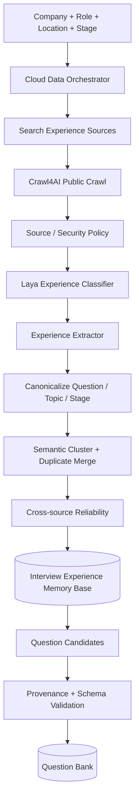

**Laya Experience Classifier** thực hiện các typed decisions nhanh:
- `company_match`: nội dung có thật sự liên quan đúng doanh nghiệp hay không.
- `role_match`: có cùng/sát vị trí đang luyện hay không.
- `seniority_match`: OJT / Intern / Fresher / Junior / Middle / Senior.
- `interview_stage`: HR / technical / coding test / take-home / case study / manager / culture-fit.
- `content_type`: reported_question / process_description / advice / company_context / noise.
- `question_worthy`: nội dung có đủ rõ để trở thành ứng viên cho Question Bank hay không.
- `duplicate_or_near_duplicate`: có trùng với trải nghiệm đã lưu hay không.
- `third_party_risk`: mức độ cần hạ độ tin cậy hoặc yêu cầu thêm nguồn xác nhận.

#### 3.1.3. Dữ liệu được trích xuất

Mỗi trải nghiệm nên được chuẩn hóa tối thiểu thành:

```json
{
  "experience_id": "exp_...",
  "company": "FPT Software",
  "role": "Java Backend Intern",
  "seniority": "intern",
  "location": "Hanoi",
  "interview_stage": "technical",
  "reported_topics": ["java_core", "sql", "project_discussion"],
  "reported_questions": [
    {
      "raw_question": "How does HashMap handle collision?",
      "canonical_concept": "java_hashmap_collision"
    }
  ],
  "process_signals": {
    "round_count": null,
    "coding_test_reported": true,
    "language_reported": ["vi", "en"]
  },
  "advice": [],
  "source_type": "third_party_candidate_report",
  "source_url": "...",
  "published_at": null,
  "fetched_at": "...",
  "official": false
}
```

Không bắt buộc mọi nguồn phải có đầy đủ các trường; trường thiếu được lưu `null` thay vì để model tự suy đoán.

#### 3.1.4. Gom cụm và tạo Collective Memory

Các câu hỏi cùng ý nghĩa nhưng khác cách diễn đạt được gom vào một canonical cluster:

```text
"HashMap hoạt động như thế nào?"
"Explain HashMap internals"
"How does Java HashMap handle collisions?"
                    ↓
        canonical_concept:
        java_hashmap_internals
```

Mỗi cluster lưu:
- `report_count`: số lần được báo cáo.
- `independent_source_count`: số nguồn độc lập.
- `company`, `role`, `seniority`, `location`.
- các `interview_stage` đã xuất hiện.
- `first_seen_at`, `last_seen_at`.
- `source_ids`.
- `reliability_score`.
- `official = false` nếu không có nguồn chính thức xác nhận.

Question Service có thể ưu tiên các cluster xuất hiện nhiều lần, mới hơn và sát role hơn, nhưng **không được diễn đạt thành “công ty chắc chắn sẽ hỏi câu này”**.

#### 3.1.5. User-Contributed Interview Debrief

Sau khi sinh viên hoàn thành một buổi phỏng vấn thật, hệ thống có thể hiển thị tùy chọn:

> “Bạn có muốn chia sẻ lại các vòng, chủ đề và câu hỏi bạn vừa gặp để giúp những sinh viên sau luyện tập tốt hơn không?”

Nếu người dùng đồng ý:
1. Thu thập nội dung bằng form hoặc voice-to-text.
2. Tách bỏ dữ liệu không cần thiết như tên người phỏng vấn, số điện thoại, email, thông tin nội bộ hoặc thông tin cá nhân của bên thứ ba.
3. Chuẩn hóa company/role/stage/topic/question.
4. Gắn `source_type = user_contributed`, `official = false`.
5. Lưu nguồn đóng góp tách biệt với câu hỏi canonical.
6. Chỉ publish sang Question Bank khi qua validation/provenance policy.

Nhờ đó, Interview Experience Memory Base tăng dần theo thời gian mà vẫn giữ được nguồn gốc và mức độ tin cậy.

---

### 3.2. Deep Company Intelligence — Thuộc Tính Chuyên Sâu Doanh Nghiệp

Company Knowledge không chỉ lưu mô tả công ty hoặc JD, mà được mở rộng thành một **Company Intelligence Profile** có cấu trúc. Mục tiêu là giúp hệ thống mô phỏng bối cảnh phỏng vấn sát vị trí thực tế hơn mà không bịa thông tin nội bộ.

#### 3.2.1. Các nhóm thuộc tính

**A. Company Identity**
- Tên pháp lý/tên thương hiệu công khai.
- Website/domain chính thức.
- Lĩnh vực kinh doanh.
- Sản phẩm/dịch vụ công khai.
- Địa điểm/văn phòng được công khai.
- Business unit hoặc đơn vị tuyển dụng nếu nguồn chính thức có nêu.

**B. Role Intelligence**
- Tên role chuẩn hóa và các alias.
- Seniority.
- Trách nhiệm chính.
- Required skills / preferred skills.
- Công nghệ/framework/tool được nhắc trong JD.
- Domain nghiệp vụ liên quan.
- Ngôn ngữ làm việc/phỏng vấn nếu được nguồn công khai nêu rõ.

**C. Engineering & Technology Signals**
- Programming languages.
- Frameworks.
- Database/data stack.
- Cloud/platform.
- DevOps/CI/CD.
- Architecture pattern được công khai.
- Engineering practices được mô tả trên blog kỹ thuật/tài liệu chính thức.
- Mỗi technology signal bắt buộc gắn `evidence_id`, nguồn và thời điểm quan sát; không được suy ra “công ty đang dùng X” chỉ từ một nguồn yếu không liên quan.

**D. Hiring Process Intelligence**
- Số vòng/phân loại vòng nếu nguồn có nêu.
- HR screening / technical / live coding / take-home / case study / manager interview.
- Công cụ coding test nếu được công khai.
- Hình thức online/offline.
- Thời lượng nếu được báo cáo.
- Phân biệt rõ trường `official_process` và `reported_process` từ bên thứ ba.

**E. Workplace & Public Culture Signals**
- Giá trị/văn hóa được doanh nghiệp công khai.
- Hình thức làm việc remote/hybrid/on-site nếu có nguồn.
- Thông tin văn phòng/location công khai.
- Các chương trình OJT/Intern/Fresher công khai.
- Không suy luận “môi trường toxic”, “áp lực cao”, “dễ đỗ”... như sự thật chỉ dựa trên review cá nhân; các nội dung đó nếu lưu phải nằm trong nhóm `third_party_reported_theme`.

**F. Recent Role-Relevant Context**
- Bài blog engineering mới.
- Sản phẩm/dịch vụ hoặc sáng kiến công nghệ công khai có liên quan tới role.
- Thay đổi JD hoặc kỹ năng tuyển dụng gần đây.
- Sự kiện/hackathon/chương trình tuyển dụng công khai liên quan.

#### 3.2.2. Data model cho từng thuộc tính

```json
{
  "attribute_id": "cmp_attr_...",
  "company_id": "company_fpt_software",
  "attribute_type": "technology_signal",
  "key": "java",
  "value": "Java",
  "role_scope": ["java_backend_intern"],
  "location_scope": ["Hanoi"],
  "source_type": "official_job_posting",
  "source_url": "...",
  "official": true,
  "confidence": 0.97,
  "first_seen_at": "...",
  "last_seen_at": "...",
  "fetched_at": "...",
  "expires_at": "...",
  "evidence_id": "ev_..."
}
```

#### 3.2.3. Entity Graph logic

Ngoài vector search, các quan hệ quan trọng được chuẩn hóa:

```text
Company
 ├── has_role ──> Role
 ├── has_product ──> Product
 ├── public_technology_signal ──> Technology
 ├── public_value ──> CultureValue
 └── has_location ──> Office/Location

Role
 ├── requires ──> Skill
 ├── prefers ──> Skill
 ├── belongs_to ──> BusinessDomain
 └── reported_interview_stage ──> InterviewStage
```

Question Service có thể truy xuất một lát cắt nhỏ của graph phù hợp với câu hỏi hiện tại thay vì đưa toàn bộ Company Knowledge vào LLM.

#### 3.2.4. Chính sách độ mới

TTL được gán theo loại dữ liệu:
- Job/JD đang tuyển: refresh nhanh.
- Hiring process/report: refresh trung bình và ưu tiên `last_seen_at`.
- Company profile/sản phẩm ổn định: refresh chậm hơn.
- Engineering blog / technology signal: refresh theo thay đổi nguồn.
- Third-party experience: giữ lịch sử nhưng giảm trọng số theo tuổi dữ liệu nếu role/process đã thay đổi.


---

## 4. Luồng Xử Lý Âm Thanh Thời Gian Thực & Biểu Đồ Tuần Tự (Realtime Voice Path)

### 4.1. Biểu đồ tuần tự chi tiết (Sequence Diagram)

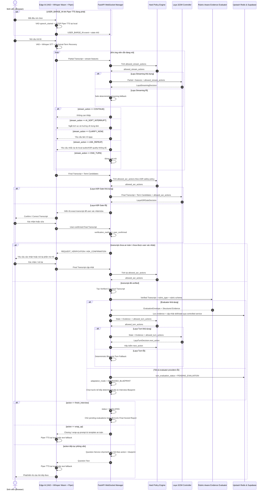


### 4.2. Bản Đồ Ranh Giới Quyết Định — Tránh Conflict Giữa Các Phase

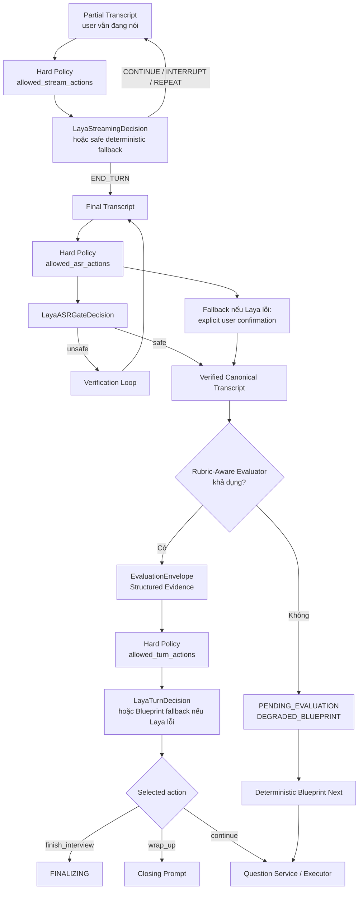

**Quy tắc chống xung đột:** mỗi phase chỉ có **một namespace action**, một authoritative input và một fallback được xác định trước. Không dùng action của phase này để thay action của phase khác; không được dùng fallback để vượt qua Verification Gate hoặc tạo điểm khi chưa có evidence.

---

## 5. Bảo Vệ Thuật Ngữ Kỹ Thuật & Chuyển Mã Ngôn Ngữ Việt - Anh (Code-switching Protection)

Sinh viên ngành CNTT và Kinh tế khi phỏng vấn thường xuyên chèn thuật ngữ tiếng Anh vào câu nói tiếng Việt:
- **Ứng viên nói:** *"Em fine-tune model bằng LoRA"*
- **STT nhận diện sai thành:** *"Em file tune model bằng Lola"*

### 5.1. Cơ chế phối hợp phục hồi 2 tầng (Two-Tier Recovery)
1. **Tầng 1 (Tại Client Edge):** Module Technical Term Recovery tạo danh sách ứng viên hoán đổi:
   - `file tune` $\rightarrow$ giữ nguyên / thay bằng `fine-tune`
   - `Lola` $\rightarrow$ giữ nguyên / thay bằng `LoRA`
2. **Tầng 2 (Tại Backend Laya ASR Gate):** Căn cứ vào transcript và ngữ cảnh kỹ thuật của câu hỏi để đưa ra 1 trong 4 quyết định:
   - `ACCEPT_AS_IS`: Transcript đã đủ rõ và không cần hiệu chỉnh; giữ nguyên nội dung để tạo Verified Canonical Transcript.
   - `ACCEPT_CORRECTION`: Chấp nhận một hiệu chỉnh thuật ngữ cụ thể nếu ngữ cảnh xung quanh có độ tương đồng kỹ thuật cao và không thuộc nhóm bất đồng trọng yếu cần hỏi lại.
   - `REQUEST_VERIFICATION`: Yêu cầu xác minh thêm trong lượt tiếp theo nếu mức độ tự tin trung bình.
   - `ASK_CONFIRMATION`: Đưa câu hỏi ngắn yêu cầu ứng viên xác nhận lại nếu việc hiểu sai làm sai lệch hoàn toàn bản chất câu trả lời.

**Verification Gate bắt buộc:** Ở đường chuẩn, `LayaASRGateDecision` phải xác nhận `transcript_safe == true`. Nếu Laya ASR Gate không khả dụng, fallback duy nhất được phép là **explicit user confirmation/correction của exact transcript** (`verification_method = user_confirmed`). Chỉ một trong hai đường này mới được tạo **Verified Canonical Transcript**. Nếu transcript chưa an toàn/chưa được user xác nhận, tuyệt đối không gọi Evaluator, không cập nhật `skill_estimates` và không ghi điểm.

### 5.2. Danh mục thuật ngữ nhạy cảm tuyệt đối không tự sửa ngầm
- `can` (có thể) $\leftrightarrow$ `can't` (không thể)
- `sync` (đồng bộ) $\leftrightarrow$ `async` (bất đồng bộ)
- `mutable` (có thể biến đổi) $\leftrightarrow$ `immutable` (bất biến)
- `authentication` (xác thực) $\leftrightarrow$ `authorization` (phân quyền)
- `INNER JOIN` $\leftrightarrow$ `LEFT JOIN`
- `fine-tuning` $\leftrightarrow$ `file tuning`

> [!CAUTION]
> **BẤT BIẾN CỐT LÕI (INVARIANT):**
> **BẢN GHI CHƯA QUA XÁC MINH (UNVERIFIED TRANSCRIPT) $\rightarrow$ TUYỆT ĐỐI KHÔNG ĐƯỢC PHÉP CẬP NHẬT ĐIỂM SỐ HAY ĐỔI TRẠNG THÁI NĂNG LỰC CỦA ỨNG VIÊN.**

---

## 6. Bộ Đánh Giá Bằng Chứng Theo Rubric (Rubric-Aware Evidence Evaluator)

Evidence Evaluator là một **service abstraction**. Provider mặc định là **Google Gemini 2.0 Flash API** với `temperature = 0.1` và Structured Outputs; có thể cấu hình một evaluator-compatible fallback provider nhưng **mọi provider phải trả cùng hợp đồng schema và đi qua validation**.

**Đầu vào chung:**
- Câu hỏi hiện tại (`current_question`)
- `Verified Canonical Transcript`
- `rubric_type`
- Rubric/schema tương ứng
- Candidate/Profile/JD/company context cần thiết
- Provenance refs liên quan

### 6.1. Evaluation Envelope chung

Mọi evaluation thành công phải được bọc trong một envelope thống nhất:

```json
{
  "$schema": "http://json-schema.org/draft-07/schema#",
  "title": "EvaluationEnvelope",
  "type": "object",
  "properties": {
    "turn_id": { "type": "string" },
    "rubric_type": {
      "type": "string",
      "enum": [
        "hr_motivation",
        "star_framework",
        "technical_correctness",
        "case_study"
      ]
    },
    "payload_schema": { "type": "string" },
    "evaluation_confidence": {
      "type": "number",
      "minimum": 0.0,
      "maximum": 1.0
    },
    "payload": { "type": "object" }
  },
  "required": [
    "turn_id",
    "rubric_type",
    "payload_schema",
    "evaluation_confidence",
    "payload"
  ],
  "additionalProperties": false
}
```

`payload` phải tiếp tục được validate bằng schema chuyên biệt theo `rubric_type`. Không được dùng một schema technical để chấm STAR/HR/Case Study. Với rubric có dimension không được hỏi trong turn hiện tại, field tương ứng phải là `null` và Stage Score Aggregator phải bỏ qua dimension đó thay vì coi là điểm 0.

### 6.2. Technical Evidence (`TechnicalEvidenceOutput`)

```json
{
  "$schema": "http://json-schema.org/draft-07/schema#",
  "title": "TechnicalEvidenceOutput",
  "type": "object",
  "properties": {
    "correctness": {
      "type": "number",
      "minimum": 0.0,
      "maximum": 1.0
    },
    "covered": {
      "type": "array",
      "items": { "type": "string" }
    },
    "missing": {
      "type": "array",
      "items": { "type": "string" }
    },
    "misconceptions": {
      "type": "array",
      "items": { "type": "string" }
    },
    "depth": {
      "type": "integer",
      "minimum": 0,
      "maximum": 5,
      "description": "0 = không có đủ nội dung để đánh giá độ sâu; 1..5 = từ nhận biết tới hiểu sâu/kiến trúc/tối ưu"
    }
  },
  "required": ["correctness", "covered", "missing", "misconceptions", "depth"],
  "additionalProperties": false
}
```

### 6.3. HR / Motivation Evidence (`HRMotivation_EvaluationOutput`)

Schema này đánh giá **nội dung có thể quan sát trong câu trả lời**, không suy luận tính cách hay trạng thái tâm lý:

```json
{
  "$schema": "http://json-schema.org/draft-07/schema#",
  "title": "HRMotivation_EvaluationOutput",
  "type": "object",
  "properties": {
    "role_motivation_specificity": {
      "type": ["number", "null"],
      "minimum": 0.0,
      "maximum": 1.0
    },
    "company_understanding_evidence": {
      "type": ["number", "null"],
      "minimum": 0.0,
      "maximum": 1.0
    },
    "learning_goal_clarity": {
      "type": ["number", "null"],
      "minimum": 0.0,
      "maximum": 1.0
    },
    "collaboration_example_quality": {
      "type": ["number", "null"],
      "minimum": 0.0,
      "maximum": 1.0
    },
    "assessed_dimensions": {
      "type": "array",
      "items": {
        "type": "string",
        "enum": [
          "role_motivation_specificity",
          "company_understanding_evidence",
          "learning_goal_clarity",
          "collaboration_example_quality"
        ]
      },
      "uniqueItems": true
    },
    "observed_points": {
      "type": "array",
      "items": { "type": "string" }
    },
    "missing_points": {
      "type": "array",
      "items": { "type": "string" }
    }
  },
  "required": [
    "role_motivation_specificity",
    "company_understanding_evidence",
    "learning_goal_clarity",
    "collaboration_example_quality",
    "assessed_dimensions",
    "observed_points",
    "missing_points"
  ],
  "additionalProperties": false
}
```

`STAR_EvaluationOutput` và `CaseStudy_EvaluationOutput` được định nghĩa ở §21.2 và §21.3 nhưng vẫn phải đi trong `EvaluationEnvelope`.

**Stage Score Aggregator:** code service (không phải LLM) map rubric payload đã validate thành stage score/radar axis theo phiên bản rubric. Evaluator không trực tiếp ghi `skill_states`; mọi cập nhật đi qua controlled scoring/state service.


### 6.4. Quy tắc Evaluation Failure

Nếu primary evaluator lỗi:
1. Có thể thử **evaluator-compatible fallback provider** với cùng rubric schema.
2. Nếu tất cả evaluator providers đều lỗi:
   - `turn_evaluation_status = PENDING_EVALUATION`
   - Không tạo score, không cập nhật `skill_estimates`, không cập nhật Long-Term Candidate Memory cho turn đó.
   - **Không tạo `LayaTurnDecision` dựa trên turn chưa có evidence.**
   - Phiên chuyển `adaptation_mode = DEGRADED_BLUEPRINT` và đi tiếp deterministically theo `Interview Blueprint`/Curated Question Bank.
   - Turn được đưa vào `evaluation_jobs` để xử lý lại bất đồng bộ.
3. Khi evidence đến muộn, controlled state service chỉ áp dụng kết quả **cho trạng thái từ thời điểm đó trở đi**; không được retroactively thay đổi các câu hỏi đã phát.
4. Final scored report chỉ được phát hành sau khi toàn bộ scored turns đã `EVALUATED`; nếu còn pending thì `report_status = PENDING_EVALUATION`.

*Quy tắc:* Evaluator chỉ tạo evidence/score theo rubric; **không có quyền chọn hành động tiếp theo của phiên phỏng vấn**.

---
---

## 7. Trạng Thái Phỏng Vấn & Cơ Chế Định Danh (Interview State & Identity)

### 7.1. Cơ chế định danh sinh viên (Authentication Strategy)
- **Profile `PILOT_DEMO` (Demo OJT & Khảo sát):** Sử dụng **Guest Session ID + LocalStorage** để test nhanh. Sinh viên nhập Họ tên & MSSV để bắt đầu. Profile này **không được bật trong production deployment có dữ liệu cá nhân bền vững**.
  - Trong giai đoạn test nhanh, **`student_id` (MSSV) là PRIMARY KEY duy nhất của sinh viên trong `candidate_profiles`**. `candidate_name` chỉ là thuộc tính hiển thị và có thể cập nhật, không tham gia định danh.
  - Mỗi lần sinh viên quay lại và nhập đúng cùng một `student_id`, backend sử dụng `student_id` để truy xuất hồ sơ, lịch sử phiên và **Long-Term Candidate Memory** tương ứng trước khi khởi tạo phiên mới.
  - `Guest Session ID` vẫn được tạo riêng cho từng phiên phỏng vấn để quản lý realtime state; nó **không thay thế `student_id`** làm định danh người dùng.
  - Cơ chế này phục vụ **demo/test nhanh**, không được xem là xác thực danh tính mạnh. Khi triển khai production rộng hoặc dữ liệu cá nhân có yêu cầu bảo vệ cao hơn, phải chuyển sang cơ chế Auth ở giai đoạn mở rộng.
- **Profile `PRODUCTION`:** Bắt buộc dùng **Supabase Auth** (ví dụ Google OAuth `@fpt.edu.vn` hoặc cơ chế tương đương). Account đã xác thực được map tới `student_id`; mọi truy xuất CV, report và Long-Term Candidate Memory phải kiểm tra quyền sở hữu account → `student_id`, không được chỉ dựa vào việc người dùng biết MSSV.

### 7.2. Cấu trúc Trạng thái Phiên (Interview State Schema)
Được đồng bộ giữa Upstash Redis (lưu trữ nóng theo phiên) và Supabase (lưu trữ bền vững):

```json
{
  "session_id": "ses_ojt_9823471",
  "candidate_name": "Nguyễn Văn A",
  "student_id": "HE180000",
  "role": "Java Backend Fresher",
  "company_target": "FPT Software",
  "current_topic": "java_core",
  "current_concept": "hashmap_internals",
  "current_difficulty": 2,
  "topic_coverage": {
    "java_core": 0.60,
    "spring_framework": 0.25,
    "database_sql": 0.15
  },
  "skill_estimates": {
    "java_core": {
      "estimate": 0.78,
      "confidence": 0.88,
      "evidence_count": 6
    },
    "spring_framework": {
      "estimate": 0.65,
      "confidence": 0.50,
      "evidence_count": 2
    }
  },
  "questions_on_current_concept": 2,
  "time_remaining_sec": 780,
  "interruption_count": 1,
  "status": "IN_PROGRESS",
  "adaptation_mode": "ADAPTIVE",
  "pending_evaluation_count": 0,
  "remaining_scored_question_budget": 8,
  "report_status": "NOT_READY"
}
```

> [!NOTE]
> Điểm ước lượng năng lực (`estimate`) và Độ tin cậy (`confidence`) bắt buộc phải tách biệt thành hai trường độc lập. Không được công nhận điểm số khi độ tin cậy chưa đạt ngưỡng cho phép.

**State semantics:**
- `status`: `IN_PROGRESS` | `FINALIZING` | `COMPLETED` | `INTERRUPTED`.
- `adaptation_mode`: `ADAPTIVE` | `DEGRADED_BLUEPRINT`.
- `pending_evaluation_count`: số turn chưa có evidence hợp lệ.
- `remaining_scored_question_budget`: số slot scored còn lại; mọi adaptive follow-up phải trừ budget.
- `report_status`: `NOT_READY` | `PENDING_EVALUATION` | `PENDING_GENERATION` | `READY`.


### 7.3. Tầng 3 — Long-Term Candidate Memory (Bộ Nhớ Ứng Viên Xuyên Phiên)

Kiến trúc bộ nhớ của ứng viên được chia thành ba tầng rõ ràng:

| Tầng | Mục đích | Storage chính | Thời gian sống |
| :--- | :--- | :--- | :--- |
| **Tầng 1 — Hot Session Memory** | State realtime của buổi đang diễn ra | Upstash Redis | Theo phiên |
| **Tầng 2 — Durable Session History** | Lưu lịch sử gốc: session, turn, evidence, report | Supabase PostgreSQL | Bền vững |
| **Tầng 3 — Long-Term Candidate Memory** | Tóm lược tri thức dài hạn về tiến bộ, điểm yếu, chủ đề cần ôn và xu hướng giao tiếp của từng sinh viên | Supabase PostgreSQL + pgvector | Xuyên nhiều phiên |

Trong giai đoạn demo/test, **`student_id` là khóa định danh chính để truy xuất Tầng 3**.

```text
student_id = HE180000
        │
        ▼
candidate_profiles
        │
        ├── session history
        ├── skill memory
        ├── concept weaknesses
        ├── retry queue
        ├── learning goals
        └── communication trend
```

#### 7.3.1. Quy tắc định danh

- `candidate_profiles.student_id` là **PRIMARY KEY**.
- `candidate_name` không phải khóa; tên được phép thay đổi/chỉnh lỗi mà không làm mất memory.
- `session_id` là khóa của từng phiên riêng lẻ và luôn liên kết về `student_id`.
- Trong `PILOT_DEMO`, khi người dùng nhập lại cùng `student_id`, hệ thống có thể tải Long-Term Candidate Memory trước khi tạo Interview Blueprint.
- Trong demo, việc biết `student_id` là đủ để truy xuất memory; đây là đánh đổi nhằm test nhanh, **không phải cơ chế xác thực an toàn cho production**.
- Trong `PRODUCTION`, chỉ sau khi account đã xác thực và được authorize map tới đúng `student_id` thì Memory Retrieval mới được phép chạy; việc chỉ nhập/biết MSSV không cấp quyền truy xuất.

#### 7.3.2. Các thành phần memory dài hạn

**A. Candidate Skill Memory**
```json
{
  "student_id": "HE180000",
  "skill": "spring_framework",
  "estimate": 0.65,
  "confidence": 0.82,
  "trend": "improving",
  "evidence_count": 12,
  "last_verified_at": "...",
  "evidence_refs": ["ev_1", "ev_9", "ev_22"]
}
```

**B. Concept Memory**
```json
{
  "student_id": "HE180000",
  "concept": "transaction_propagation",
  "status": "weak",
  "confidence": 0.90,
  "last_result": "partial",
  "retry_priority": 0.86,
  "last_seen_at": "...",
  "evidence_refs": ["ev_34"]
}
```

**C. Retry Queue**
- Các câu/chủ đề đã trả lời chưa đạt.
- Mức ưu tiên retry.
- Ngày gần nhất đã retry.
- Số lần retry liên tiếp.
- Điều kiện để đưa concept ra khỏi queue: đủ evidence mới và confidence vượt ngưỡng.

**D. Learning Goals**
- Mục tiêu do user tự chọn.
- Mục tiêu được báo cáo cuối session đề xuất.
- Deadline/ngày phỏng vấn thật nếu user nhập.
- Role/company target liên quan.

**E. Long-Term Communication Memory**
- Không lưu kết luận tâm lý.
- Chỉ lưu các chỉ báo giao tiếp có thể quan sát và xu hướng theo thời gian: tốc độ nói, pause ratio, filler-word rate, mức lặp ý, answer length, self-correction.
- Chỉ dùng cho coaching giao tiếp, không thay đổi điểm technical.

#### 7.3.3. Memory Consolidation sau mỗi buổi phỏng vấn

Memory Consolidation chỉ chạy khi `pending_evaluation_count == 0`. Nếu session đã kết thúc nhưng còn turn `PENDING_EVALUATION`, consolidation được giữ ở trạng thái pending; không được tạo Final Skill State từ dữ liệu thiếu.

Sau khi toàn bộ scored turn đã được evaluation:

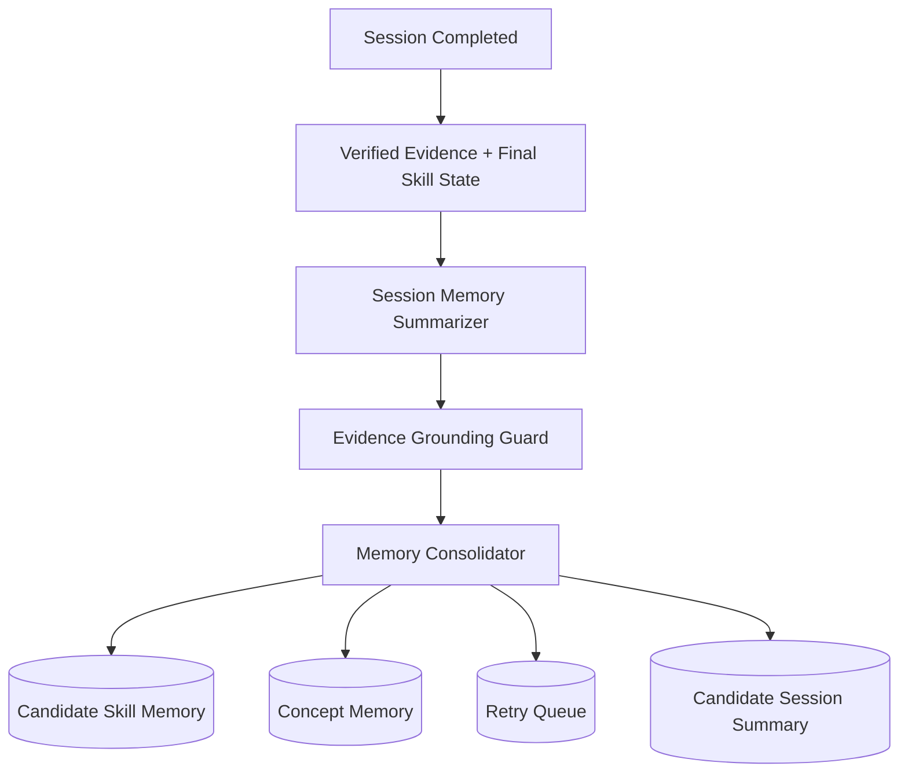

**Memory Consolidator** tuân thủ các quy tắc:
1. Chỉ dùng evidence đã xác minh.
2. Không lấy câu trả lời ASR chưa xác minh làm memory.
3. Không overwrite mù quáng memory cũ; nếu evidence mới mâu thuẫn, lưu cả bằng chứng mới và cập nhật estimate/confidence theo policy.
4. Mọi memory item đều có `created_at`, `updated_at`, `source_session_id`, `evidence_refs`.
5. Memory quan trọng phải truy vết được về evidence gốc.
6. Những nhận xét chỉ xuất hiện một lần với confidence thấp không được nâng thành “đặc điểm cố định” của ứng viên.

#### 7.3.4. Memory Retrieval trước phiên mới

Khi sinh viên nhập `student_id` và chọn role/company:

```text
student_id
   ↓
Candidate Memory Retrieval
   ↓
lọc theo role / skill / recency / retry priority
   ↓
Compact Memory Context
   ↓
Interview Blueprint
```

Ví dụ Compact Memory Context:

```json
{
  "student_id": "HE180000",
  "recent_strengths": ["java_hashmap", "sql_join"],
  "weak_concepts": ["spring_transaction_propagation"],
  "retry_queue": ["spring_transaction_propagation", "composite_index"],
  "skill_trend": {
    "java_core": "improving",
    "spring_framework": "stagnant"
  },
  "last_session_at": "..."
}
```

Không đưa toàn bộ transcript của nhiều buổi vào context; chỉ lấy compact memory + các evidence refs cần thiết.

#### 7.3.5. Hỏi lại sau khi phỏng vấn

Long-Term Candidate Memory cũng được dùng như một nguồn retrieval cho giao diện trợ lý:

```text
User:
"Lần trước em yếu phần nào?"
      ↓
student_id
      ↓
Candidate Memory Query Service
      ↓
memory + evidence refs
      ↓
Grounded answer
```

Nhờ đó sau nhiều ngày hoặc nhiều buổi, hệ thống vẫn biết được tiến trình trước đó của cùng `student_id` thay vì bắt đầu lại từ đầu.


---

## 8. Mặt Phẳng Điều Khiển Laya System-1 (Laya System-1 Control Plane)

Mô hình **Laya Multilingual 322M** được nhóm huấn luyện chuyên biệt đóng vai trò là "Bộ não phản xạ System-1" của hệ thống backend.

### 8.1. Quyết định Streaming của Laya (`LayaStreamingDecision`)

Dùng **chỉ khi ứng viên đang nói**. Laya phải chọn trong `allowed_stream_actions` do Hard Policy Engine xác định.

```json
{
  "$schema": "http://json-schema.org/draft-07/schema#",
  "title": "LayaStreamingDecision",
  "type": "object",
  "properties": {
    "stream_action": {
      "type": "string",
      "enum": [
        "CONTINUE",
        "AI_SOFT_INTERRUPT",
        "CLARIFY_NOW",
        "ASK_REPEAT",
        "END_TURN"
      ]
    },
    "stream_confidence": {
      "type": "number",
      "minimum": 0.0,
      "maximum": 1.0
    }
  },
  "required": ["stream_action", "stream_confidence"],
  "additionalProperties": false
}
```

### 8.2. Quyết định ASR Gate của Laya (`LayaASRGateDecision`)

Dùng **sau khi đã có Final Transcript nhưng trước Evidence Evaluator**. Đây là schema duy nhất quyết định transcript có đủ an toàn để trở thành `Verified Canonical Transcript` hay không.

```json
{
  "$schema": "http://json-schema.org/draft-07/schema#",
  "title": "LayaASRGateDecision",
  "type": "object",
  "properties": {
    "transcript_safe": {
      "type": "boolean"
    },
    "asr_gate_action": {
      "type": "string",
      "enum": [
        "ACCEPT_AS_IS",
        "ACCEPT_CORRECTION",
        "REQUEST_VERIFICATION",
        "ASK_CONFIRMATION"
      ]
    },
    "asr_confidence": {
      "type": "number",
      "minimum": 0.0,
      "maximum": 1.0
    }
  },
  "required": ["transcript_safe", "asr_gate_action", "asr_confidence"],
  "additionalProperties": false
}
```

`LayaASRGateDecision` chỉ được chọn trong `allowed_asr_actions`. Nếu Laya ASR Gate không khả dụng, chỉ được dùng explicit user confirmation/correction của exact transcript làm deterministic fallback. Khi transcript chưa verified, pipeline **dừng tại ASR Gate**; không gọi Evaluator và không tạo Turn Decision.

### 8.3. Quyết định Sau Lượt của Laya (`LayaTurnDecision`)

Dùng **chỉ sau khi** đã có `Verified Canonical Transcript` và `EvaluationEnvelope` hợp lệ cho turn hiện tại. Nếu evaluation đang `PENDING_EVALUATION`, không gọi `LayaTurnDecision`; hệ thống dùng deterministic Blueprint fallback.

```json
{
  "$schema": "http://json-schema.org/draft-07/schema#",
  "title": "LayaTurnDecision",
  "type": "object",
  "properties": {
    "answer_intent": {
      "type": "string",
      "enum": ["direct_answer", "clarification_question", "give_up", "irrelevant", "pause"]
    },
    "relevance": {
      "type": "number",
      "minimum": 0.0,
      "maximum": 1.0
    },
    "decision_confidence": {
      "type": "number",
      "minimum": 0.0,
      "maximum": 1.0
    },
    "next_action": {
      "type": "string",
      "enum": [
        "probe",
        "same_level",
        "harder",
        "easier",
        "switch_topic",
        "clarify_answer",
        "verify_reasoning",
        "finish_topic",
        "wrap_up",
        "finish_interview"
      ]
    },
    "difficulty_action": {
      "type": "string",
      "enum": ["increase", "maintain", "decrease"]
    },
    "escalate_to_strong_llm": {
      "type": "boolean"
    }
  },
  "required": ["answer_intent", "relevance", "decision_confidence", "next_action"],
  "additionalProperties": false
}
```

`LayaTurnDecision` chỉ được chọn trong `allowed_turn_actions`.

> [!IMPORTANT]
> Ba họ quyết định **không được dùng thay cho nhau**:
> - `LayaStreamingDecision`: điều khiển realtime khi user đang nói.
> - `LayaASRGateDecision`: xác minh Final Transcript.
> - `LayaTurnDecision`: quyết định bước phỏng vấn tiếp theo sau khi đã có evidence.
>
> `Partial Transcript` chỉ phục vụ Streaming Decision. `Final Transcript` đi qua ASR Gate. Chỉ `Verified Canonical Transcript` mới được đưa vào Evidence Evaluator, scoring và memory.

*Quy tắc cốt lõi:* Laya chỉ sinh typed decision token trong schema tương ứng, **không trực tiếp sinh câu chữ câu hỏi phỏng vấn**.

---
## 9. Cắt Lời Theo Luồng & Chen Ngang (Streaming Interruption & Barge-in)

Hai cơ chế được tách biệt rõ ràng theo **hướng ngắt lời**:
- **`USER_BARGE_IN` (User → AI):** Sinh viên bắt đầu nói khi Piper TTS đang phát. Đây là phản xạ local mang tính tất định; Silero VAD tại client dừng Piper ngay lập tức, **không chờ Laya, Hard Policy hay round-trip Cloud**. Sau đó client chỉ gửi event/state nhỏ lên backend để đồng bộ.
- **`AI_SOFT_INTERRUPT` (AI → User):** Hệ thống muốn ngắt ứng viên vì nói quá dài, lạc đề nghiêm trọng hoặc lặp ý. Quyết định này chạy tại Server/Cloud và phải đi qua **Hard Policy → `allowed_stream_actions` → LayaStreamingDecision** trước khi phát tín hiệu ngắt lịch sự về client.

Partial transcript được máy khách truyền liên tục theo khoảng thời gian $300\text{ms} - 500\text{ms}$ để Laya tạo `LayaStreamingDecision`. Bộ hành động streaming chuẩn là:

| Hành động | Điều kiện kích hoạt | Phản ứng của hệ thống |
| :--- | :--- | :--- |
| `CONTINUE` | Ứng viên đang trả lời bình thường, bám sát chủ đề. | Để ứng viên tiếp tục nói, không can thiệp. |
| `AI_SOFT_INTERRUPT` | Ứng viên nói quá dài (>90s), lạc đề nghiêm trọng hoặc lặp lại ý. | Sau khi Hard Policy cho phép và Laya chọn hành động, máy chủ gửi tín hiệu lịch sự ngắt lời và hướng ứng viên về trọng tâm. |
| `CLARIFY_NOW` | Phát hiện nhầm lẫn khái niệm trọng yếu làm sai lệch hoàn toàn ngữ cảnh. | Ngắt lời tức thời để làm rõ trước khi tiếp tục. |
| `ASK_REPEAT` | Local audio bị rè/clipping, AudioWorklet/ring-buffer drop, VAD/Whisper local cho tín hiệu không ổn định hoặc transcript không đủ chất lượng. | Yêu cầu ứng viên nhắc lại câu trả lời vừa rồi. Raw audio vẫn không rời thiết bị. |
| `END_TURN` | Hết thời gian cho phép của câu hỏi hoặc ứng viên im lặng > 3 giây. | Đóng lượt nói, tạo Final Transcript và chuyển sang ASR Gate. **Chưa được chấm điểm tại bước này.** |

**Điều kiện kỹ thuật dưới đây chỉ áp dụng cho `AI_SOFT_INTERRUPT` (AI ngắt ứng viên), không áp dụng cho `USER_BARGE_IN`:**
1. Không yêu cầu `Verified Canonical Transcript`; streaming control được phép sử dụng **partial transcript** vì quyết định phải được đưa ra khi ứng viên vẫn đang nói.
2. Partial ASR phải đạt mức ổn định tối thiểu theo streaming policy (ví dụ confidence/stability đủ cao qua nhiều chunk liên tiếp); nếu tín hiệu quá bất ổn thì chỉ được `CONTINUE` hoặc dùng fallback audio-quality phù hợp.
3. Đã thu thập đủ ngữ cảnh ngữ nghĩa (không ngắt khi ứng viên mới nói 1-2 từ đệm như "dạ", "à thì").
4. Tín hiệu ngắt phải được phát hiện lặp lại qua nhiều khung thời gian liên tiếp (repeated detection), tránh ngắt chỉ vì một partial chunk nhất thời.
5. `stream_confidence` phải vượt ngưỡng được cấu hình sẵn (ví dụ $\ge 0.85$ đối với `AI_SOFT_INTERRUPT`).
6. Hành động phải nằm trong `allowed_stream_actions` do Hard Policy Engine xác định.

> [!IMPORTANT]
> **Partial transcript chỉ được dùng cho realtime streaming control** như `CONTINUE`, `AI_SOFT_INTERRUPT`, `CLARIFY_NOW`, `ASK_REPEAT`, `END_TURN`. Partial transcript **không được dùng để chấm điểm, cập nhật `skill_estimates`, Long-Term Candidate Memory hoặc tạo authoritative evidence**. Các tác vụ đó chỉ được phép sau khi có `Verified Canonical Transcript`.

---

## 10. Động Cơ Chính Sách Cứng Bằng Mã Lệnh (Hard Policy Engine)

Mã nguồn bằng code thuần túy (Code) luôn có quyền lực tối cao hơn tất cả các mô hình AI.

**Ranh giới vai trò:**
- **Hard Policy Engine = constraint/validator:** tạo tập hành động hợp lệ theo đúng giai đoạn.
- Streaming phase → `allowed_stream_actions`.
- ASR Gate phase → `allowed_asr_actions`.
- Turn phase → `allowed_turn_actions`.
- **Laya = decision selector:** chỉ được chọn một action nằm trong tập tương ứng.
- Laya không được tự mở rộng các tập action; Hard Policy không thay Laya suy luận ngữ nghĩa câu trả lời.

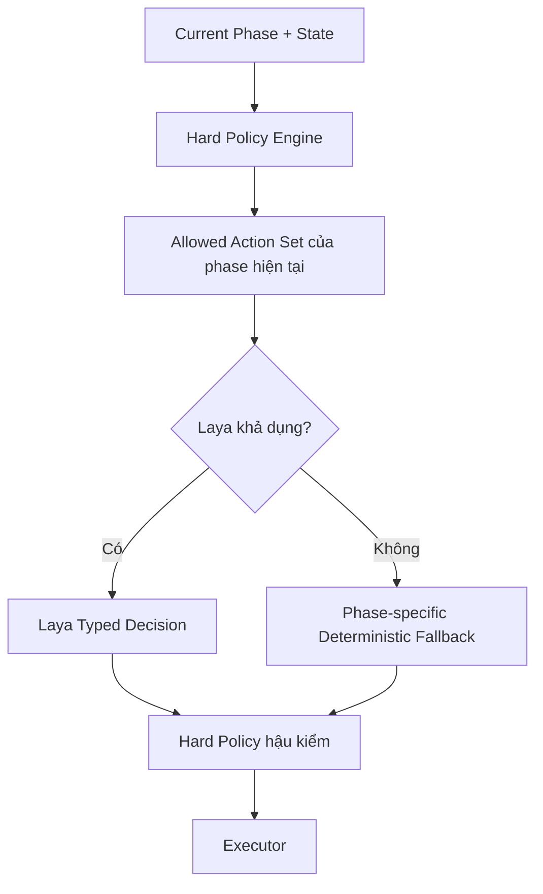

**Thứ tự thực thi bắt buộc:** Hard Policy luôn chạy trước để tạo tập action của **phase hiện tại**. Nếu Laya khả dụng, Laya chọn đúng một action trong tập đó; nếu Laya lỗi, chỉ được dùng fallback tất định đã khai báo riêng cho phase. Sau đó Policy hậu kiểm. Không có action namespace dùng chung cho Streaming, ASR Gate và Turn Decision.

**Các quy tắc cứng bất di bất dịch:**
- **Turn/time rule:** Nếu `time_remaining_sec < 60` $\rightarrow$ `allowed_turn_actions` chỉ còn `wrap_up` hoặc `finish_interview`.
- **Scoring gate:** Nếu `transcript_safe == false` $\rightarrow$ cấm Evidence Evaluator, cấm cập nhật `skill_estimates`, cấm Long-Term Memory và **không được tạo `LayaTurnDecision`**.
- **Probe limit:** Nếu `questions_on_current_concept >= 3` $\rightarrow$ loại `probe` khỏi `allowed_turn_actions`.
- **Question budget:** mọi adaptive follow-up (`probe`, `same_level`, `harder`, `easier`) tiêu thụ một `remaining_scored_question_budget` slot. Khi stage/global budget hết, loại các action sinh thêm scored question và chuyển stage/wrap-up theo Blueprint.

- **Critical ASR disagreement:** Nếu có bất đồng ở từ khóa trọng yếu $\rightarrow$ `allowed_asr_actions` chỉ được chứa `REQUEST_VERIFICATION` và/hoặc `ASK_CONFIRMATION`; không được `ACCEPT_AS_IS` hay tự sửa ngầm.
- **Evaluator unavailable:** turn chưa có evidence bị gắn `PENDING_EVALUATION`; cấm score/skill/memory update và cấm adaptive `LayaTurnDecision`. Chỉ cho phép deterministic progression theo Blueprint.
- **Finish rule:** `finish_interview` chuyển session sang `FINALIZING`; action này **không được** gọi Question Service để sinh câu hỏi mới.


---

## 11. Dịch Vụ Câu Hỏi (Question Service)

### 11.1. Thứ tự ưu tiên nguồn câu hỏi
1. **Ngân hàng câu hỏi chuẩn hóa (Curated Question Bank):** Bộ câu hỏi OJT tiêu chuẩn đã được kiểm duyệt theo từng role.
2. **Mẫu câu hỏi điền khuyết (Template + Slot-filling):** Ghép ngữ cảnh công ty vào khung câu hỏi chuẩn.
3. **Sinh bằng mô hình LLM nhỏ/vừa (Gemini 2.0 Flash):** Sinh câu hỏi tình huống dựa trên câu trả lời trước đó.
4. **Strong LLM (Gemini 2.0 Pro):** Chỉ kích hoạt khi cần cá nhân hóa sâu theo dự án độc nhất trong CV của sinh viên.

### 11.2. Lưu vết nguồn gốc bắt buộc (Provenance Tracking)
Mọi câu hỏi được phát ra đều phải có metadata đủ để truy vết **nguồn tri thức hoặc ngữ cảnh sinh câu hỏi**, nhưng không bắt buộc mọi loại câu hỏi phải có một URL duy nhất:

- `source_type`: `official_jd` | `tech_blog` | `docs` | `third_party` | `curated` | `template_generated` | `ai_generated`.
- `source_url`: URL trực tiếp của nguồn khi tồn tại; **nullable** đối với `ai_generated`, `template_generated` hoặc câu hỏi curated không bắt nguồn từ một trang web cụ thể.
- `source_refs[]`: Danh sách tham chiếu tới các nguồn/knowledge items dùng để hình thành câu hỏi; cho phép rỗng khi không có external source trực tiếp.
- `evidence_refs[]`: Danh sách `evidence_id` hoặc knowledge evidence làm căn cứ cho nội dung/cá nhân hóa câu hỏi.
- `fetched_at`: Thời điểm thu thập đối với nguồn web; nullable nếu không áp dụng.
- `verification_status`: Trạng thái kiểm duyệt/validation của câu hỏi.
- `expiry`: Thời hạn hiệu lực khi câu hỏi phụ thuộc dữ liệu có tính thời điểm; nullable với câu hỏi nền tảng ổn định.
- `generation_model`: Bắt buộc khi `source_type = ai_generated`; ghi model/version đã sinh câu hỏi.
- `generation_context_refs[]`: Bắt buộc với câu hỏi AI-generated để chỉ rõ transcript/evidence/CV/JD/knowledge items đã được đưa vào ngữ cảnh sinh.

**Quy tắc:** `source_url = null` không đồng nghĩa với “không có provenance”. Với câu hỏi AI-generated, provenance được xác lập bằng `generation_model + generation_context_refs[] + evidence_refs[]`; hệ thống tuyệt đối không được gán một URL giả chỉ để thỏa schema.


### 11.3. Execution Semantics theo `next_action`

- `probe`, `same_level`, `harder`, `easier`, `switch_topic`, `clarify_answer`, `verify_reasoning`, `finish_topic` → Question Service được phép chọn/sinh **câu hỏi tiếp theo** theo `Interview Blueprint` và provenance policy.
- `wrap_up` → dùng closing/wrap-up template; không bắt đầu một topic đánh giá mới.
- `finish_interview` → **không gọi Question Service**; chuyển session sang `FINALIZING`.

### 11.4. Reverse Interview Answer Service

Reverse Interview là một turn riêng, **không phải** `LayaTurnDecision` và không đi qua Evidence Evaluator để chấm ứng viên.

```text
Candidate voice/text question
        ↓
Local STT (nếu voice)
        ↓
ASR Verification Gate
        ↓
Verified Reverse Question
        ↓
Company/JD/Official Knowledge Retrieval
        ↓
Grounded Answer Generator
        ↓
Provenance Validation
        ↓
Text → Piper TTS local
```

- Chỉ trả lời từ JD, Company Knowledge và nguồn có provenance.
- Nếu chỉ có third-party information, phải gắn nhãn rõ.
- Nếu không đủ bằng chứng, trả lời “chưa có thông tin xác minh” thay vì bịa.
- Reverse turn không cập nhật technical score, skill estimate hoặc Long-Term Candidate Memory về năng lực.

---

## 12. Phát Âm Thanh Tại Thiết Bị Đầu Cuối & Chen Ngang (Edge TTS / Barge-in)

- **Nguyên lý:** Máy chủ Backend chỉ truyền chuỗi văn bản câu hỏi (`text only`) về trình duyệt để tiết kiệm tối đa băng thông mạng.
- **Phát âm thanh tại máy:** Module `Piper TTS Wasm` trên trình duyệt nhận text và tạo âm thanh trực tiếp bằng CPU người dùng.
- **Cơ chế `USER_BARGE_IN` (sinh viên ngắt AI):**
  - Trong suốt quá trình Piper TTS đang phát loa, `Silero VAD` vẫn liên tục lắng nghe tín hiệu micro từ AudioWorklet.
  - Ngay khoảnh khắc người dùng cất tiếng nói, toàn bộ phản xạ ban đầu diễn ra **tại local, không chờ Laya trên server**:
    1. Trình duyệt ngắt tức thời luồng phát âm thanh của Piper (`audioContext.suspend()` / ngắt buffer).
    2. Chuyển trạng thái giao diện sang `LISTENING` (Đang lắng nghe bạn nói).
    3. Bắt đầu đưa microphone audio vào Whisper STT **tại local**.
    4. Gửi event `USER_BARGE_IN` và state nhỏ lên backend để đồng bộ; **không gửi raw audio**.
- **Phân biệt với `AI_SOFT_INTERRUPT`:** `USER_BARGE_IN` là user ngắt AI và được xử lý local tức thời; `AI_SOFT_INTERRUPT` là AI ngắt user và phải được Hard Policy + Laya tại server quyết định.


### 12.1. Communication Behavior Monitor — Đánh Giá Cách Trình Bày Thay Vì Đoán Cảm Xúc

Hệ thống **không cố gắng suy luận trực tiếp “ứng viên đang nghĩ gì”, “đang lo âu”, “đang nói dối” hoặc “có tự tin hay không” chỉ từ giọng nói**. Thay vào đó, hệ thống đo các tín hiệu giao tiếp có thể quan sát được và kết hợp với self-report của chính ứng viên để tạo coaching feedback có căn cứ hơn.

#### 12.1.1. Edge Feature Extraction

Các đặc trưng nhỏ được tính tại client từ VAD, Web Audio và transcript:

- `response_latency_ms`: thời gian từ lúc câu hỏi kết thúc tới khi user bắt đầu nói.
- `speech_rate_wpm`: tốc độ nói.
- `pause_ratio`: tỷ lệ thời gian tạm dừng.
- `long_pause_count`: số khoảng dừng dài vượt ngưỡng.
- `filler_word_count`: số từ đệm như “ờ”, “à”, “ừm”, “kiểu là”...
- `restart_count`: số lần bắt đầu lại câu.
- `self_correction_count`: số lần tự sửa nội dung.
- `answer_duration_sec`: tổng thời lượng câu trả lời.
- `repetition_score`: mức lặp ý.
- `too_quiet_or_clipped`: tín hiệu âm thanh quá nhỏ hoặc clipping.
- `barge_in_count`: số lần user chen lời khi AI đang nói.

Các phép đo này có thể được triển khai bằng rule/feature extractor cục bộ hoặc classifier ONNX rất nhỏ, vì vậy **không cần gửi raw audio lên Cloud**.

#### 12.1.2. Không biến tín hiệu âm thanh thành kết luận tâm lý

Các output cho phép là dạng mô tả hành vi:

```json
{
  "delivery_signals": {
    "speech_rate_wpm": 108,
    "pause_ratio": 0.24,
    "long_pause_count": 5,
    "filler_word_count": 9,
    "restart_count": 3
  },
  "delivery_pattern": [
    "frequent_long_pauses",
    "high_filler_usage"
  ]
}
```

Không tạo các nhãn chắc chắn kiểu:
- `anxious = true`
- `confident = false`
- `lying = true`
- `thinking_about_X = true`

Nếu cần một chỉ báo tổng hợp để điều phối coaching, chỉ dùng các nhãn trung tính như:
- `delivery_fluent`
- `delivery_hesitant_pattern`
- `delivery_rambling_pattern`
- `delivery_too_brief`
- `audio_quality_problem`

#### 12.1.3. Self-Reported State

Sau một câu khó hoặc theo chu kỳ vài câu, hệ thống có thể hỏi nhanh:

```text
Bạn cảm thấy câu vừa rồi thế nào?

[ Dễ ]
[ Bình thường ]
[ Khó ]
[ Em biết nhưng diễn đạt chưa tốt ]
[ Em chưa chắc kiến thức ]
```

Self-report được lưu riêng với timestamp và question/turn ID.

#### 12.1.4. Kết hợp ba nguồn để tạo coaching insight

```text
Technical Evidence
        +
Observable Communication Features
        +
Candidate Self-Report
        ↓
Communication Coaching Aggregator
        ↓
Grounded Coaching Insight
```

Ví dụ:
- Technical correctness cao.
- Pause ratio cao.
- User tự chọn “Biết nhưng diễn đạt chưa tốt”.

Kết luận phù hợp:
> “Kiến thức ở câu này tương đối chắc, nhưng phần trình bày có nhiều khoảng dừng; nên luyện cách cấu trúc câu trả lời ngắn theo từng ý.”

Không kết luận:
> “Bạn thiếu tự tin.”

#### 12.1.5. Quan hệ với điểm số

- Communication Behavior **không được phép làm thay đổi technical correctness score**.
- Có thể tạo một thang coaching riêng như `communication_clarity`, `conciseness`, `response_structure`.
- Mọi feedback phải trỏ về các feature cụ thể hoặc self-report.
- Long-Term Candidate Memory chỉ lưu xu hướng giao tiếp theo thời gian, không lưu “tính cách” hay “trạng thái tâm lý cố định”.


---

## 13. Kiến Trúc Lưu Trữ Không Máy Chủ (Serverless Storage Architecture)

```
Supabase (PostgreSQL 16)
├── candidate_profiles   (Hồ sơ sinh viên, MSSV, trường lớp)
├── jobs                 (Vị trí tuyển dụng OJT, yêu cầu JD)
├── sessions             (Phiên phỏng vấn, trạng thái, thời gian)
├── turns                (Metadata từng lượt: turn_type, evaluation_status, question/action refs; không chứa transcript dùng để chấm điểm)
├── turn_transcripts_raw (ASR raw/partial/final chưa xác minh, confidence, timestamp; tuyệt đối không dùng cho scoring)
├── turn_transcripts_verified (Canonical transcript đã xác minh, verification_method, verified_at, verified_by/source)
├── evidence             (EvaluationEnvelope + rubric payload; chỉ tham chiếu turn_transcripts_verified)
├── evaluation_jobs      (Hàng đợi retry cho turn PENDING_EVALUATION)
├── skill_states         (Điểm kỹ năng tích lũy & độ tin cậy)
├── questions            (Ngân hàng câu hỏi kèm provenance metadata)
├── company_knowledge    (Tri thức doanh nghiệp kèm embedding vector pgvector)
├── company_attributes   (Thuộc tính chuyên sâu công ty kèm provenance, TTL, confidence)
├── interview_experiences (Kinh nghiệm phỏng vấn công khai / user-contributed đã chuẩn hóa)
├── reported_questions   (Câu hỏi người đi trước báo cáo từng gặp, liên kết source/cluster)
├── experience_sources   (Nguồn gốc, URL, loại nguồn, thời điểm crawl, độ tin cậy)
├── experience_clusters  (Canonical concept/question cluster và thống kê số nguồn độc lập)
├── candidate_memory_profiles (Long-Term Candidate Memory tổng hợp theo student_id)
├── candidate_skill_memory    (Skill estimate/confidence/trend xuyên phiên)
├── candidate_concept_memory  (Memory theo concept, evidence refs, retry priority)
├── candidate_retry_queue     (Danh sách concept/câu hỏi cần luyện lại)
├── candidate_session_summaries (Tóm tắt grounded của từng session cho retrieval dài hạn)
├── communication_features    (Chỉ báo giao tiếp quan sát được theo turn/session)
├── reports              (Báo cáo tổng kết hoàn chỉnh)
└── audit_logs           (decision/evaluation type, model_version, policy_version, schema_version, confidence, input refs, timestamp, validation status)

Upstash Redis
├── session:{id}:hot_state    (Trạng thái nóng cập nhật theo giây)
├── session:{id}:turn_buffer  (Đệm các gói partial transcript)
├── candidate:{student_id}:memory_cache (Compact Long-Term Candidate Memory dùng cho phiên hiện tại)
└── ratelimit:{client_ip}     (Chống spam yêu cầu phỏng vấn)

Supabase Storage / Object Storage
├── resumes/             (File CV gốc dạng PDF của sinh viên)
├── crawl_snapshots/     (Snapshot/trích đoạn nguồn crawl cần lưu để audit provenance)
└── reports_pdf/         (Bản xuất báo cáo PDF cho sinh viên tải về)
```

**Transcript storage invariant:** `turn_transcripts_raw` và `turn_transcripts_verified` là hai bảng/collection tách biệt. Evidence Evaluator, skill update, report và Long-Term Candidate Memory chỉ được phép đọc transcript từ `turn_transcripts_verified`; raw ASR text chỉ phục vụ debug/audit và verification. Bảng `turn_transcripts_raw` **không chứa raw microphone audio**.

---

## 14. Báo Cáo Đánh Giá Tổng Kết (Final Report)

Được tổng hợp bởi **Google Gemini 2.0 Pro** sau khi phiên phỏng vấn kết thúc:

**Dữ liệu đầu vào:**
- Hồ sơ sinh viên & Vị trí ứng tuyển OJT
- Trạng thái kỹ năng đạt được cuối cùng (`final skill state`)
- Toàn bộ bằng chứng thu thập được qua từng lượt (`structured evidence list`)
- Các đoạn trích tiêu biểu từ **Verified Canonical Transcript**
- Ngữ cảnh thực tế của doanh nghiệp mục tiêu

**Điều kiện phát hành:** `Final Scored Report` chỉ được tạo khi mọi scored turn đã `EVALUATED`. Nếu còn `PENDING_EVALUATION`, `report_status = PENDING_EVALUATION`; nếu evidence đã đủ nhưng Strong LLM/report generator lỗi, `report_status = PENDING_GENERATION`. Hệ thống không phát hành điểm tổng kết thiếu evidence và không tự bịa phần còn thiếu.

**Cấu trúc Báo cáo bàn giao cho sinh viên:**
1. **Điểm mạnh nổi bật:** Những kiến thức sinh viên thể hiện đúng, có bằng chứng và trình bày rõ ràng, đúng trọng tâm.
2. **Lỗ hổng kiến thức cốt lõi:** Những khái niệm còn thiếu, hiểu sai hoặc chưa đạt độ sâu theo chuẩn tuyển dụng.
3. **Giải thích có dẫn chứng đối chứng:** Trích dẫn trực tiếp câu trả lời của sinh viên làm bằng chứng cụ thể.
4. **Ví dụ câu trả lời chuẩn mực (Better-answer examples):** Cách trả lời ấn tượng hơn để ghi điểm với nhà tuyển dụng OJT.
5. **Lộ trình học tập & khắc phục cá nhân hóa:** Danh sách tài liệu, chủ đề cần ôn tập cấp tốc trước ngày phỏng vấn thật.
6. **Thử thách lại (Questions to retry):** Danh sách các câu hỏi sinh viên đã trả lời chưa tốt để luyện tập lại.

---

## 15. Các Kịch Bản Lỗi & Cơ Chế Dự Phòng (Failure Modes & Fallbacks)

| Tình huống sự cố | Hành vi dự phòng (Fallback Behavior) |
| :--- | :--- |
| **Mất kết nối Internet / Backend gián đoạn** | **Tạm dừng phiên ngay.** Client chỉ giữ `session_id`, timer snapshot, turn buffer và UI state ngắn hạn để reconnect. Không hỏi tiếp, không chấm điểm, không đổi difficulty và không cập nhật memory khi Backend không khả dụng. Reconnect thành công thì đồng bộ state rồi mới tiếp tục; quá timeout → `INTERRUPTED`. |
| **Laya Streaming không phản hồi** | Tắt AI soft-interrupt mang tính ngữ nghĩa; mặc định `CONTINUE`. `END_TURN` vẫn có thể được kích hoạt bởi timer/VAD rule tất định; local audio-quality rule có thể yêu cầu `ASK_REPEAT`. |
| **Laya ASR Gate không phản hồi** | Không tự `ACCEPT_AS_IS`/`ACCEPT_CORRECTION`. Hiển thị exact transcript cho ứng viên xác nhận/sửa. Chỉ khi user xác nhận thì tạo Verified Canonical Transcript với `verification_method=user_confirmed`. |
| **Laya Turn Decision không phản hồi** | Không dùng rule “độ dài/từ khóa” để giả lập reasoning. Chuyển `adaptation_mode=DEGRADED_BLUEPRINT`; Hard Policy + Interview Blueprint chọn câu kế tiếp tất định, không adaptive probe/harder/easier dựa trên Laya. |
| **Primary Evidence Evaluator lỗi** | Thử evaluator-compatible fallback provider với cùng rubric schema nếu được cấu hình. |
| **Tất cả Evidence Evaluator providers lỗi** | Mark turn `PENDING_EVALUATION`; không score/skill/memory update, không gọi adaptive `LayaTurnDecision`; tiếp tục non-adaptive theo Blueprint/Curated Question Bank và enqueue `evaluation_jobs`. |
| **Report LLM không phản hồi** | Session có thể kết thúc nhưng `report_status=PENDING_GENERATION`; retry sau. Không phát hành Final Scored Report bằng nội dung suy đoán. |
| **Piper TTS lỗi** | Chuyển sang hiển thị text; không gửi audio lên server. |
| **Whisper local lỗi** | Chuyển sang Local Degraded Text Input; voice mode tạm tắt, không có Server-Assisted Audio Fallback. |
| **ASR không chắc chắn / critical term disagreement** | Yêu cầu user xác nhận hoặc nhắc lại; tuyệt đối không tự suy đoán nghĩa. |

**Nguyên tắc fallback:** fallback chỉ được **giảm mức tự động hóa**, không được hạ thấp Verification/Scoring invariants. Khi một model không khả dụng, hệ thống ưu tiên deterministic behavior hoặc explicit user confirmation thay vì để model khác tự vượt policy.

---
---

## 16. Các Bất Biến Trong Môi Trường Production (Production Invariants)

1. **Unverified transcript never affects score:** transcript chưa verified không được ảnh hưởng tới score, skill state, report hoặc Long-Term Candidate Memory.
2. **Raw ASR text is separate from canonical transcript:** `turn_transcripts_raw` tách khỏi `turn_transcripts_verified`; không bảng nào mặc định chứa raw microphone audio.
3. **Critical technical corrections require verification:** không tự sửa ngầm bất đồng thuật ngữ trọng yếu.
4. **Phase isolation:** Streaming, ASR Gate, Evaluation, Turn Decision và Reverse Interview có input/output/action namespace riêng; không dùng action của phase này thay phase khác.
5. **Hard Policy is authoritative:** Laya hoặc fallback chỉ được chọn/thực thi hành động nằm trong tập code-approved của phase hiện tại.
6. **LLM cannot mutate durable state directly:** mọi ghi state/score/memory phải qua controlled service + schema/policy validation.
7. **Evaluation-before-adaptation:** adaptive `LayaTurnDecision` chỉ tồn tại khi turn hiện tại đã có `EvaluationEnvelope` hợp lệ. `PENDING_EVALUATION` chỉ được đi theo deterministic Blueprint.
8. **Finish means no new question:** `finish_interview` → `FINALIZING`, không gọi Question Service.
9. **Final report is evidence-complete:** không phát hành Final Scored Report nếu còn scored turn `PENDING_EVALUATION`.
10. **Control/evaluation auditability:** mọi typed Laya control decision và mọi evaluation output ảnh hưởng score phải ghi `model_version`, `policy_version`, `schema_version`, confidence, input refs, timestamp và validation status. Pure text generation phải ghi model/version + provenance + validation status nhưng không bắt buộc giả tạo một confidence không được model hỗ trợ.
11. **Raw audio local by default:** microphone stream/PCM/Opus/WebM không được gửi Backend trong interview path mặc định. Opt-in training storage là data-flow riêng.
12. **Crawler never blocks live turn loop:** crawl/search chạy async/cache-first.
13. **Third-party information is labeled:** không trình bày experience/review bên thứ ba như thông tin chính thức của doanh nghiệp.
14. **Realtime interview requires Backend connectivity:** mất kết nối chỉ cho phép pause/reconnect; không có authoritative offline interview mode.
15. **Production identity is authenticated:** Guest/MSSV-only retrieval chỉ được phép trong `PILOT_DEMO`; `PRODUCTION` phải authorize account → `student_id` trước khi truy xuất dữ liệu bền vững.

### 16.1. Audit Record tối thiểu

```json
{
  "event_type": "laya_turn_decision | laya_asr_decision | laya_stream_decision | evaluation",
  "session_id": "ses_...",
  "turn_id": "turn_...",
  "model_version": "model@version",
  "policy_version": "policy@version",
  "schema_version": "schema@version",
  "confidence": 0.91,
  "input_refs": ["..."],
  "validation_status": "VALID",
  "created_at": "..."
}
```

Với generative-only output như report/question text, audit dùng provenance + validation status; không ép model tạo confidence giả.

---
---

## 17. Cấu Trúc Mã Nguồn Dự Án Monorepo (Project Scaffolding & Directory Tree)

Hệ thống được tổ chức thống nhất trong một Monorepo:

```
cóc working/
├── Coc_Di_Lam_Final_Architecture.md    # Tài liệu kiến trúc hoàn chỉnh tiếng Việt (File này)
├── Project Proposal.pdf                # Đề xuất gốc của Nhóm 1 FPT
├── docs/                               # Tài liệu hướng dẫn & hợp đồng API
│   ├── api_contracts.md                # Đặc tả chi tiết các payload WebSocket & REST
│   └── schemas/                        # File định nghĩa JSON Schema độc lập
│       ├── laya_streaming_decision.schema.json
│       ├── laya_asr_gate_decision.schema.json
│       ├── laya_turn_decision.schema.json
│       ├── evaluation_envelope.schema.json
│       ├── technical_evidence.schema.json
│       ├── hr_motivation_evidence.schema.json
│       ├── star_evaluation.schema.json
│       ├── case_study_evaluation.schema.json
│       └── audit_record.schema.json
│
├── frontend/                           # Giao diện người dùng Web App (Next.js 15)
│   ├── public/
│   │   ├── models/                     # Checkpoint VAD ONNX & Piper voices
│   │   └── wasm/                       # File nhị phân WASM cho Whisper & Piper
│   ├── src/
│   │   ├── app/
│   │   │   ├── layout.tsx              # Khung giao diện dùng chung, Navbar & Footer
│   │   │   ├── page.tsx                # Trang chủ (Hero Cóc Đi Làm, giới thiệu 2 phân hệ)
│   │   │   ├── cv-lab/
│   │   │   │   └── page.tsx            # Phân hệ 1: Lab Tối ưu CV theo JD
│   │   │   ├── interview/
│   │   │   │   ├── page.tsx            # Chọn vị trí / công ty phỏng vấn OJT
│   │   │   │   └── [sessionId]/
│   │   │   │       └── page.tsx        # Phân hệ 2: Phòng Phỏng vấn Giọng nói Realtime 1-1
│   │   │   └── report/
│   │   │       └── [sessionId]/
│   │   │           └── page.tsx        # Báo cáo đánh giá, nhận xét & lộ trình học tập
│   │   ├── components/
│   │   │   ├── interview/
│   │   │   │   ├── AudioVisualizer.tsx # Hiệu ứng sóng âm thanh tương tác
│   │   │   │   ├── ControlBar.tsx      # Nút bật/tắt mic, kết thúc phiên
│   │   │   │   └── TranscriptBox.tsx   # Hộp hiển thị transcript realtime
│   │   │   ├── cv/
│   │   │   │   ├── CVUploader.tsx      # Tải lên file CV PDF/DOCX
│   │   │   │   └── GapAnalysisCard.tsx # Thẻ phân tích khoảng cách kỹ năng
│   │   │   └── common/
│   │   │       ├── Header.tsx
│   │   │       └── GuestModal.tsx      # Chỉ bật trong PILOT_DEMO; nhập tên & MSSV nhanh
│   │   ├── hooks/
│   │   │   ├── useAudioRecorder.ts     # Quản lý Micro & AudioWorklet
│   │   │   └── useInterviewSocket.ts   # Kết nối WebSocket streaming với Backend
│   │   ├── workers/                    # Web Workers chạy ngầm
│   │   │   ├── vad.worker.ts           # Silero VAD Worker
│   │   │   ├── whisper.worker.ts       # Whisper STT Wasm Worker
│   │   │   └── piper.worker.ts         # Piper TTS Wasm Worker
│   │   └── lib/
│   │       ├── supabase.ts             # Khách hàng Supabase phía Client
│   │       └── utils.ts
│   ├── package.json
│   ├── tsconfig.json
│   └── tailwind.config.ts
│
└── backend/                            # Dịch vụ máy chủ FastAPI
    ├── app/
    │   ├── api/
    │   │   ├── v1/
    │   │   │   ├── cv.py               # REST API phân tích cú pháp & chấm điểm CV
    │   │   │   ├── sessions.py         # Quản lý phiên phỏng vấn & báo cáo
    │   │   │   └── questions.py        # Truy xuất Ngân hàng câu hỏi
    │   ├── core/
    │   │   ├── config.py               # Cấu hình biến môi trường
    │   │   ├── database.py             # Kết nối Supabase PostgreSQL
    │   │   └── redis.py                # Kết nối Upstash Redis Serverless
    │   ├── models/
    │   │   ├── schemas.py              # Streaming/ASR/Turn Decisions, EvaluationEnvelope, State
    │   │   └── db_models.py            # SQLAlchemy / Supabase ORM models
    │   ├── services/
    │   │   ├── laya_controller.py      # Bộ nạp & điều khiển mô hình Laya 322M
    │   │   ├── hard_policy_engine.py   # Rào chắn chính sách cứng bằng mã Python
    │   │   ├── evidence_evaluator.py   # Rubric-aware evaluator + compatible provider fallback
    │   │   ├── evaluation_queue.py     # Retry PENDING_EVALUATION jobs
    │   │   ├── decision_audit.py       # Audit typed decisions/evaluations
    │   │   ├── question_service.py     # Lựa chọn câu hỏi & provenance tracking
    │   │   ├── reverse_interview_service.py # Grounded answer cho Reverse Interview
    │   │   ├── cv_analyzer.py          # Thuật toán phân tích khoảng cách CV theo JD
    │   │   └── crawler_service.py      # Crawl4AI worker thu thập dữ liệu web
    │   ├── websocket/
    │   │   └── interview_turn_ws.py    # Quản lý luồng streaming WebSocket turn-by-turn
    │   └── main.py                     # Khởi tạo ứng dụng FastAPI
    ├── requirements.txt
    └── .env.example
```

---

## 18. Tổng Kết Mô Hình & Dịch Vụ Nền Tảng (Final Recommended Stack)

| Tầng kiến trúc | Công nghệ & Mô hình tuyển chọn | Vai trò kỹ thuật chính |
| :--- | :--- | :--- |
| **Client Edge VAD** | Silero VAD ONNX (Web Worker) | Bắt tiếng nói tức thời, triệt để tiết kiệm CPU trình duyệt. |
| **Client Edge STT** | Whisper Base Multilingual Wasm | Nhận diện giọng nói đa ngữ Việt - Anh độ trễ thấp tại máy. |
| **Client Edge TTS** | Piper TTS Wasm (`vi_VN-vais1000-medium`) | Phát âm thanh giọng đọc tiếng Việt mượt mà ngay tại máy khách. |
| **Control Plane** | Laya Multilingual 322M (Checkpoint nhóm) | Phân loại, routing, ASR gating, quyết định hành động logic. |
| **Hard Policy** | Python Code Engine | Rào chắn nghiệp vụ tối cao, ngăn chặn AI vi phạm quy tắc. |
| **Evidence Evaluator**| Rubric-aware service; Gemini 2.0 Flash primary + optional compatible fallback | Trả `EvaluationEnvelope` + rubric payload; failure → `PENDING_EVALUATION`, không score/adapt. |
| **Strong LLM** | Google Gemini 2.0 Pro API | Sinh câu hỏi khó/report hoặc evaluator-compatible fallback khi được cấu hình đúng schema; không được bypass evidence policy. |
| **Web Crawler** | Crawl4AI + Gemini Flash tool-calling | Cào dữ liệu tuyển dụng, blog kỹ thuật của doanh nghiệp. |
| **Database** | Supabase (PostgreSQL 16 + `pgvector`) | Lưu trữ bền vững dữ liệu quan hệ và tìm kiếm ngữ nghĩa vector. |
| **Cache & Realtime** | Upstash Redis Serverless | Lưu trữ trạng thái phiên nóng, rate limit, thời gian thực. |
| **Client UI** | Next.js 15 (App Router) + Tailwind CSS | Giao diện hiện đại, tối ưu phản xạ âm thanh, tương thích mọi thiết bị. |

---

## 19. Kiến Trúc Chi Tiết Phân Hệ 1: Phòng Lab Tối Ưu CV 4 Tầng (CV & JD Lab Deep Architecture)

Nhằm hiện thực hóa trọn vẹn cam kết trong Project Proposal (*"Khi tải CV lên, hệ thống sẽ chỉ ra các điểm thiếu sót và đề xuất cách tinh chỉnh sát với yêu cầu tuyển dụng, đồng thời tự động tạo kịch bản phỏng vấn chuyên sâu theo từng vị trí"*), Phân hệ 1 được chuẩn hóa thành pipeline 4 tầng chuyên sâu:

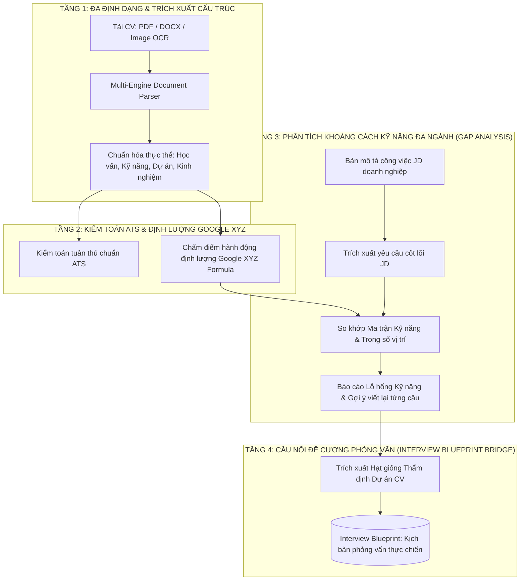

### 19.1. Tầng 1: Đa Định Dạng & Trích Xuất Cấu Trúc (Multi-Format Document Parsing)
- **Hỗ trợ định dạng:** PDF (vector text và bản scan hình ảnh qua OCR), Microsoft Word (.docx), Plain Text (.txt).
- **Hỗ trợ song ngữ:** Xử lý tự nhiên cả CV tiếng Việt, tiếng Anh hoặc CV pha trộn thuật ngữ song ngữ.
- **Công cụ trích xuất:** Kết hợp `pdfplumber` / `pypdf` cho tài liệu văn bản chuẩn và `Google Gemini 2.0 Flash Multimodal Vision` cho các CV dạng ảnh/thiết kế đồ họa phức tạp (Canva, Photoshop).
- **Trích xuất thực thể chuẩn hóa (Canonical Entity Extraction):**
  - Thông tin ứng viên: Họ tên, Email, Số điện thoại, Địa chỉ, Link GitHub/LinkedIn/Portfolio.
  - Trình độ học vấn: Trường đại học, Chuyên ngành, Điểm GPA (nếu có), Năm tốt nghiệp dự kiến.
  - Kỹ năng (Skills): Kỹ năng chuyên môn cứng (Hard skills), Kỹ năng mềm (Soft skills), Công cụ/Phần mềm (Tools).
  - Dự án & Kinh nghiệm: Tên dự án, Vai trò cá nhân, Công nghệ/Phương pháp sử dụng, Kết quả đạt được.
  - Chứng chỉ chuyên môn & Giải thưởng (Certifications & Awards).

### 19.2. Tầng 2: Kiểm Toán Chuẩn ATS & Công Thức Định Lượng Google XYZ
- **Kiểm toán tương thích ATS (Applicant Tracking System Compliance Audit):**
  - Phát hiện các lỗi định dạng gây kẹt robot lọc hồ sơ: bảng biểu lồng nhau (nested tables), hình ảnh đồ họa chứa chữ quan trọng, font chữ không chuẩn, cột phân chia quá phức tạp.
  - Kiểm tra tính đầy đủ của các phân mục bắt buộc (Contact, Summary, Skills, Experience/Projects, Education).
- **Đánh giá sức nặng câu từ theo Công thức Google XYZ:**
  - Tiêu chuẩn công thức: *"Đã hoàn thành [X], được đo lường bằng [Y], thông qua việc thực hiện [Z]"* (*Accomplished [X] as measured by [Y], by doing [Z]*).
  - Tự động phát hiện các câu mô tả mơ hồ, thụ động (ví dụ: *"Tham gia hỗ trợ làm dự án web"* $\rightarrow$ cảnh báo thiếu số liệu định lượng, thiếu vai trò cá nhân).
  - Tính toán chỉ số hành động (`Action Verb Ratio`) và chỉ số định lượng (`Quantified Metric Score`).

### 19.3. Tầng 3: Phân Tích Khoảng Cách Kỹ Năng Đa Ngành (Gap Analysis vs JD)
- **Thuật toán so khớp ngữ nghĩa:** So sánh vector embedding và danh mục kỹ năng giữa CV và JD mục tiêu theo từng khối ngành.
- **Phân loại khoảng cách (Gap Classification):**
  - **Critical Hard Gaps:** Kỹ năng bắt buộc phải có trong JD nhưng hoàn toàn không tìm thấy trong CV (ví dụ: JD yêu cầu *Spring Boot & Docker*, CV chỉ có *Java Core*).
  - **Depth Gaps:** Có nhắc đến kỹ năng nhưng mức độ mô tả quá nông, chỉ dừng ở mức biết khái niệm môn học.
  - **Context Mismatch:** Kỹ năng có nhưng áp dụng vào lĩnh vực khác hoàn toàn so với sản phẩm của công ty tuyển dụng.
- **Gợi ý viết lại trực tiếp (Sentence-level Actionable Rewrites):**
  - Đưa ra mẫu câu viết lại tối ưu chuẩn ATS nhưng giữ nguyên tính trung thực, không bịa đặt kinh nghiệm giả.
  - Đề xuất bổ sung các từ khóa chuyên ngành còn thiếu trực tiếp vào phần kỹ năng và tóm tắt.

### 19.4. Tầng 4: Cầu Nối Đề Cương Phỏng Vấn (Interview Blueprint Bridge)
- **Tạo hạt giống thẩm định dự án (Project Defense Seeds):**
  - Trích xuất từng dự án trong CV thành một hồ sơ con gồm: Công nghệ tuyên bố $\rightarrow$ Vai trò ứng viên $\rightarrow$ Kiến trúc/Quy trình $\rightarrow$ Điểm nghi vấn tiềm tàng.
  - Chuyển giao trực tiếp sang Phân hệ 2 để phỏng vấn viên AI đào sâu: *"Trong CV bạn có ghi dùng Redis để cache dữ liệu, bạn giải quyết bài toán cache invalidation như thế nào?"* hoặc *"Trong chiến dịch Marketing bạn ghi tăng 35% tương tác, bạn đã đo lường chỉ số đó qua công cụ gì?"*.
- **Thẩm định nội dung CV (CV Claim Defense):** Yêu cầu sinh viên giải trình các claim đã ghi trong CV bằng chi tiết kỹ thuật/nghiệp vụ có thể truy vết. Hệ thống chỉ đánh giá **mức độ evidence hỗ trợ claim**, không kết luận ứng viên gian lận hay nói dối.

---

## 20. Khung Kiến Trúc Đa Ngành & Từ Điển Chuyển Mã Mở Rộng (Multi-Disciplinary Domain Framework)

Để đáp ứng định hướng **xây dựng hệ thống mở rộng đa ngành** theo quy mô thực tế của các kỳ OJT đại học (Công nghệ thông tin, Kinh tế, Quản trị, Marketing, Tài chính...), hệ thống áp dụng kiến trúc **Gói Miền Tri Thức Cắm Rút (Pluggable Domain Knowledge Packs)**:

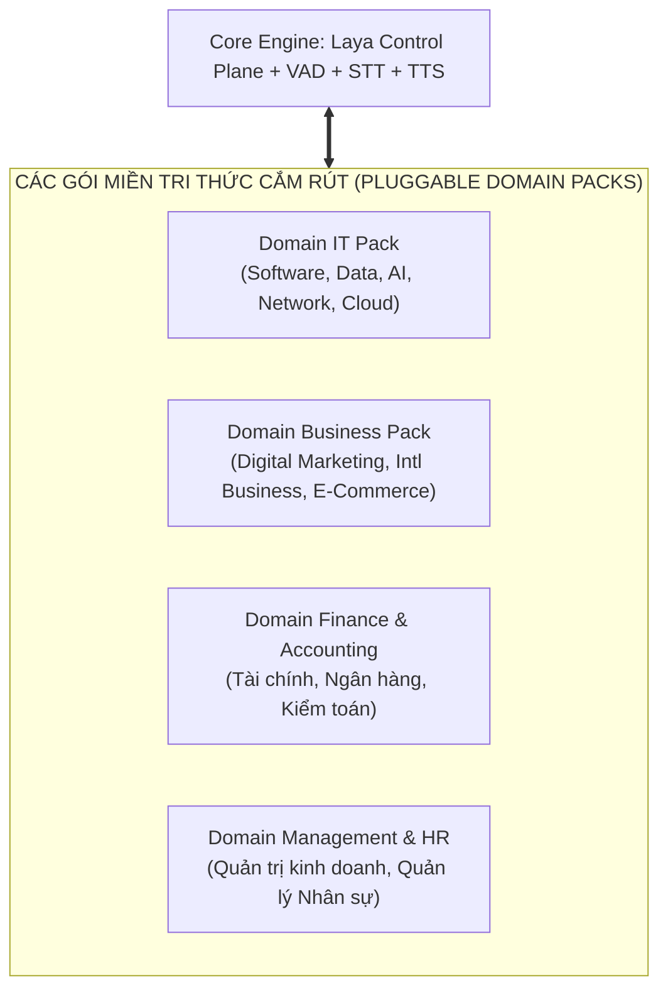

### 20.1. Danh mục các Gói Miền Tri Thức (Domain Knowledge Packs)
Mỗi Domain Pack chứa 3 thành phần độc lập:
1. **Domain Lexicon:** Bảng từ điển thuật ngữ chuyên ngành và các cặp từ đồng âm dễ nhận diện sai trong tiếng Việt - Anh.
2. **Domain Concept Ontology:** Cây quan hệ khái niệm kỹ thuật và tiêu chuẩn nghiệp vụ.
3. **Domain Evaluation Rubrics:** Bộ tiêu chí chấm điểm chuyên biệt cho các bài toán đặc thù của ngành.

### 20.2. Bảng Đối Soát Chuyển Mã Ngôn Ngữ Khối Ngành Kinh Tế & Kinh Doanh
Bên cạnh bảng thuật ngữ kỹ thuật IT tại Mục 4 & 5, hệ thống tích hợp danh mục bảo vệ thuật ngữ chuyển mã cho khối Kinh tế - Quản trị:

| Thuật ngữ gốc ứng viên nói | Lỗi nhận diện STT tiềm tàng | Cặp phân biệt rủi ro cao (Tuyệt đối không sửa ngầm) | Ý nghĩa nghiệp vụ tuyển dụng |
| :--- | :--- | :--- | :--- |
| **B2B** (Business to Business) | "B to B", "bi hai bi", "B2C" | `B2B` $\leftrightarrow$ `B2C` | Sai lệch hoàn toàn đối tượng khách hàng mục tiêu |
| **CAC** (Customer Acquisition Cost)| "Cát", "C A C", "LTV" | `CAC` $\leftrightarrow$ `LTV` | Đổi ngược hoàn toàn giữa Chi phí sở hữu và Giá trị vòng đời |
| **ROI** (Return on Investment) | "R O I", "Râu y", "ROE" | `ROI` $\leftrightarrow$ `ROE` / `ROA` | Nhầm lẫn giữa Tỷ suất hoàn vốn đầu tư và Lợi nhuận trên vốn chủ |
| **KPI** (Key Performance Indicator)| "K B I", "K P I", "OKR" | `KPI` $\leftrightarrow$ `OKR` | Nhầm lẫn giữa Chỉ số đo lường hiệu suất và Mục tiêu then chốt |
| **Conversion Rate** | "Cân vơ dần rết", "tỷ lệ chuyển"| `Conversion Rate` $\leftrightarrow$ `Click-through Rate` | Đổi từ Tỷ lệ chốt đơn sang Tỷ lệ nhấp chuột |
| **Cash Flow** | "Cát lâu", "dòng tiền" | `Cash Flow` $\leftrightarrow$ `Profit Margin` | Dòng tiền thực tế so với Tỷ suất lợi nhuận sổ sách |
| **Top-line** (Doanh thu) | "Tóp lai", "Doanh số" | `Top-line` $\leftrightarrow$ `Bottom-line` | Doanh thu tổng (Top-line) so với Lợi nhuận ròng (Bottom-line) |
| **Inbound Marketing** | "In bao marketing", "Ao bao" | `Inbound` $\leftrightarrow$ `Outbound` | Chiến lược tiếp thị thu hút so với tiếp thị bám đuổi |

---

## 21. Kiến Trúc Đa Vòng Phỏng Vấn OJT & Rubric Đánh Giá STAR / Case Study (Multi-Stage OJT Interview Engine)

Một buổi phỏng vấn OJT chuyên nghiệp không chỉ kiểm tra lý thuyết đơn thuần mà đánh giá ứng viên toàn diện theo 4 giai đoạn tiêu chuẩn:

```mermaid
journey
    title HÀNH TRÌNH 4 GIAI ĐOẠN PHỎNG VẤN OJT TOÀN DIỆN
    section Vòng 1: HR & Động Lực
      Khởi động & Phá băng: 5: Phỏng vấn viên
      Động lực & Mục tiêu học tập OJT: 5: Ứng viên
    section Vòng 2: Thẩm Định Dự Án CV
      Kiểm tra mức độ giải trình claim CV: 4: Phỏng vấn viên
      Trình bày theo mô hình STAR: 4: Ứng viên
    section Vòng 3: Nền Tảng Chuyên Môn
      Câu hỏi cốt lõi theo vị trí JD: 3: Phỏng vấn viên
      Đào sâu bản chất & Tối ưu: 3: Ứng viên
    section Vòng 4: Tình Huống / Case Study
      Đặt bài toán thực tế doanh nghiệp: 2: Phỏng vấn viên
      Phân tích phản xạ & Giải pháp: 2: Ứng viên
```

### 21.1. Bốn Vòng Đánh Giá Tiêu Chuẩn Trong Phiên Phỏng Vấn
1. **Vòng 1: Khởi Động & Động Lực Ứng Tuyển (HR & Motivation Round):**
   - Đánh giá mức độ cụ thể của động lực ứng tuyển, hiểu biết về role/company, mục tiêu học tập và chất lượng ví dụ hợp tác mà ứng viên **trình bày trong câu trả lời**; không suy luận tính cách hay trạng thái tâm lý.
2. **Vòng 2: Thẩm Định Dự Án Trong CV (Behavioral & Project Defense Round):**
   - Bắt buộc ứng viên trình bày các trải nghiệm thực tế dựa trên **Phương pháp STAR**:
     - **S (Situation - Bối cảnh):** Bối cảnh dự án/bài toán diễn ra ở đâu, vấn đề là gì?
     - **T (Task - Nhiệm vụ):** Trách nhiệm cụ thể của ứng viên trong nhóm là gì?
     - **A (Action - Hành động):** Ứng viên đã tự mình triển khai những giải pháp kỹ thuật/nghiệp vụ nào?
     - **R (Result - Kết quả):** Kết quả đo lường định lượng cụ thể ra sao?
3. **Vòng 3: Kiến Thức Nền Tảng Chuyên Môn (Core Domain Competency Round):**
   - Phỏng vấn sâu các kiến thức trọng tâm theo JD của từng ngành (IT, Marketing, Tài chính, Logistics).
4. **Vòng 4: Tình Huống Thực Chiến Doanh Nghiệp (Applied Scenario & Business Case Study):**
   - Đưa ra một bài toán lỗi/khủng hoảng thực tế: đối với IT là sập kết nối database hoặc rò rỉ dữ liệu; đối với Kinh tế là chiến dịch quảng cáo bị khiếu nại hoặc đối thủ giảm giá mạnh. Đánh giá tư duy phân tích nguyên nhân gốc rễ (Root cause analysis) và phản xạ đưa ra giải pháp.

### 21.2. Đặc Tả JSON Schema Cho Đánh Giá STAR (`STAR_EvaluationOutput`)
```json
{
  "$schema": "http://json-schema.org/draft-07/schema#",
  "title": "STAR_EvaluationOutput",
  "type": "object",
  "properties": {
    "situation_clarity": {
      "type": "number",
      "minimum": 0.0,
      "maximum": 1.0,
      "description": "Bối cảnh vấn đề được trình bày rõ ràng, đủ thông tin nền"
    },
    "task_definition": {
      "type": "number",
      "minimum": 0.0,
      "maximum": 1.0,
      "description": "Mục tiêu và trách nhiệm cụ thể của cá nhân ứng viên"
    },
    "action_depth": {
      "type": "number",
      "minimum": 0.0,
      "maximum": 1.0,
      "description": "Hành động thực chất, mô tả chi tiết phương pháp cá nhân đã làm"
    },
    "result_quantification": {
      "type": "number",
      "minimum": 0.0,
      "maximum": 1.0,
      "description": "Kết quả có số liệu đo lường, bài học kinh nghiệm rút ra"
    },
    "ownership_evidence_strength": {
      "type": "number",
      "minimum": 0.0,
      "maximum": 1.0,
      "description": "Mức độ cụ thể và nhất quán của bằng chứng trong câu trả lời cho thấy phạm vi đóng góp của ứng viên; không được dùng để kết luận ứng viên nói dối hay thực sự/không thực sự làm dự án"
    },
    "role_ownership": {
      "type": "string",
      "enum": ["primary_builder", "contributor", "observer", "unclear"],
      "description": "Phạm vi vai trò/đóng góp được ứng viên mô tả và được câu trả lời hiện tại hỗ trợ; không phải kết luận độc lập về sự thật lịch sử"
    },
    "missing_star_components": {
      "type": "array",
      "items": { "type": "string", "enum": ["situation", "task", "action", "result"] }
    }
  },
  "required": [
    "situation_clarity", 
    "task_definition", 
    "action_depth", 
    "result_quantification", 
    "ownership_evidence_strength", 
    "role_ownership", 
    "missing_star_components"
  ],
  "additionalProperties": false
}
```


> [!IMPORTANT]
> `ownership_evidence_strength` chỉ đo mức độ cụ thể, nhất quán và có thể truy vết của bằng chứng mà ứng viên cung cấp về phần việc của mình. Trường này **không phải** xác suất nói thật/nói dối, không được dùng để suy luận gian lận, và không được biến thành kết luận tâm lý hay đạo đức về ứng viên.

### 21.3. Đặc Tả JSON Schema Cho Đánh Giá Tình Huống Case Study (`CaseStudy_EvaluationOutput`)
```json
{
  "$schema": "http://json-schema.org/draft-07/schema#",
  "title": "CaseStudy_EvaluationOutput",
  "type": "object",
  "properties": {
    "problem_structuring": {
      "type": "number",
      "minimum": 0.0,
      "maximum": 1.0,
      "description": "Khả năng phân rã bài toán phức tạp thành các phần có thể xử lý"
    },
    "root_cause_identification": {
      "type": "number",
      "minimum": 0.0,
      "maximum": 1.0,
      "description": "Xác định đúng nguyên nhân cốt lõi thay vì chữa phần ngọn"
    },
    "solution_feasibility": {
      "type": "number",
      "minimum": 0.0,
      "maximum": 1.0,
      "description": "Tính khả thi thực tế về mặt chi phí, nhân lực và thời gian"
    },
    "business_impact_awareness": {
      "type": "number",
      "minimum": 0.0,
      "maximum": 1.0,
      "description": "Ý thức về rủi ro, trải nghiệm người dùng và tác động tài chính"
    },
    "structured_framework_used": {
      "type": "string",
      "description": "Khung tư duy được sử dụng (vd: MECE, SWOT, 5 Whys, 4P, Divide-and-Conquer)"
    }
  },
  "required": [
    "problem_structuring", 
    "root_cause_identification", 
    "solution_feasibility", 
    "business_impact_awareness"
  ],
  "additionalProperties": false
}
```

---

## 22. Chiến Lược Phân Phối Edge AI, IndexedDB Caching & Local Degraded Fallback

Để vận hành ổn định trên hạ tầng mạng Wi-Fi trường đại học và hỗ trợ đa dạng cấu hình máy tính của sinh viên, kiến trúc triển khai mô hình Edge tuân thủ nghiêm ngặt quy trình tối ưu 3 bước:

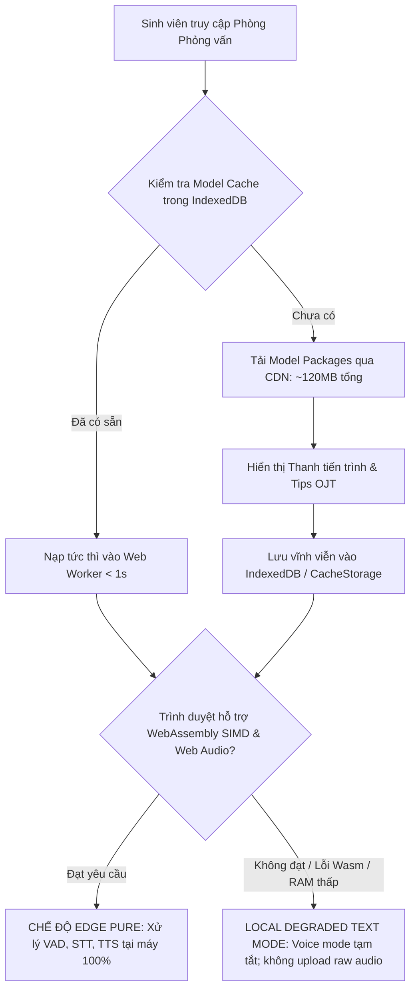

### 22.1. Quản Lý Bộ Nhớ Đệm Trình Duyệt (Browser Model Cache Management)
- **Kích thước gói mô hình Edge:**
  - `Silero VAD ONNX`: ~2MB.
  - `Whisper Base Multilingual Quantized Wasm`: ~75MB.
  - `Piper TTS vi_VN-vais1000-medium Wasm`: ~42MB.
  - **Tổng dung lượng tải lần đầu:** $\approx 119\text{MB}$.
- **Cơ chế lưu trữ:** Sử dụng `IndexedDB` kết hợp `Cache API` của trình duyệt. Mỗi model được gắn kèm mã băm kiểm tra tính toàn vẹn (SHA-256 Checksum).
- **Khởi động tức thì (Zero-Latency Reconnect):** Kể từ lần truy cập thứ hai, toàn bộ mô hình được nạp thẳng từ bộ nhớ đệm ổ cứng cục bộ vào Web Worker trong thời gian chưa đầy $1$ giây mà không tiêu tốn thêm bất kỳ byte băng thông Internet nào.

### 22.2. Trải Nghiệm Người Dùng Khi Tải Mô Hình Lần Đầu (Loading UX)
- Giao diện cung cấp thanh tiến trình chi tiết (% tải từng model).
- Trong lúc chờ tải lần đầu (khoảng 15-30 giây tùy tốc độ mạng), hệ thống tự động hiển thị thẻ bài học kinh nghiệm OJT (*"Tips trả lời phỏng vấn theo phương pháp STAR"*, *"Cách đối phó khi quên từ vựng tiếng Anh"*), biến thời gian chờ thành trải nghiệm học tập hữu ích.

### 22.3. Cơ Chế Suy Giảm Cục Bộ Không Upload Raw Audio (Local Degraded Mode Invariant)
Nhằm bảo đảm nguyên tắc **raw audio luôn được xử lý tại thiết bị**, hệ thống **không sử dụng Server-Assisted Audio Fallback** và không tự động stream microphone audio lên FastAPI Backend khi Edge gặp lỗi. Backend chỉ nhận **transcript, state và small JSON**; Laya 322M, Hard Policy, LLM Orchestrator, Evidence Evaluator và các dịch vụ tri thức tiếp tục chạy tại Server/Cloud.

- **Phát hiện suy thoái tự động (Auto Degradation Detection):** Nếu quá trình khởi tạo Web Worker STT/TTS gặp lỗi, trình duyệt thiếu tài nguyên hoặc model Edge không thể nạp thành công, Edge Runtime Orchestrator chuyển sang chế độ suy giảm cục bộ phù hợp **nhưng phiên vẫn bắt buộc duy trì kết nối Internet tới Backend**.
- **Fallback không rời thiết bị:**
  - Nếu **Piper TTS lỗi** $\rightarrow$ hiển thị câu hỏi dạng văn bản trên giao diện; không gửi audio lên server.
  - Nếu **Whisper STT lỗi nhưng giao diện vẫn hoạt động** $\rightarrow$ chuyển sang nhập câu trả lời bằng văn bản cho đến khi STT local được khôi phục hoặc người dùng đổi thiết bị/trình duyệt.
  - Nếu **mất Internet / mất kết nối Backend** $\rightarrow$ **tạm dừng phiên ngay lập tức**. Client chỉ giữ `session_id`, timer snapshot, turn buffer và UI state cục bộ để thử reconnect; không hỏi câu tiếp theo, không gọi fallback Question Bank offline, không chấm điểm, không điều chỉnh difficulty và không cập nhật memory.
  - Nếu reconnect thành công trong cửa sổ cho phép $\rightarrow$ đồng bộ lại state với Backend rồi mới tiếp tục phiên; nếu quá timeout $\rightarrow$ đánh dấu phiên `INTERRUPTED`.
- **Bất biến truyền dữ liệu:** Microphone stream, PCM, Opus, WebM hoặc raw audio tương đương **không được gửi lên Backend trong realtime interview path**. Chỉ transcript đã qua xử lý cục bộ, state và small JSON được phép truyền. Nếu có chương trình opt-in lưu audio phục vụ nghiên cứu/huấn luyện, nó phải là pipeline riêng với consent rõ ràng và không được dùng làm runtime fallback.

---

## 23. Quy Chuẩn Phiên Phỏng Vấn Toàn Diện Duy Nhất (Single Full-Scale OJT Interview Mode)

Thay vì chia nhỏ thành nhiều chế độ ngắn gây phân tán trải nghiệm, hệ thống chuẩn hóa **Duy nhất một Chế độ Phỏng vấn Toàn diện (Unified Comprehensive OJT Interview)**. Mọi phiên phỏng vấn đều được thiết kế như một buổi phỏng vấn doanh nghiệp thật sự với cấu trúc chặt chẽ:

### 23.1. Cấu Hình Phiên Tiêu Chuẩn
- **Tổng thời lượng:** $20 - 25\text{ phút}$ (có đồng hồ đếm ngược hiển thị trên giao diện).
- **Ngân sách câu hỏi scored chuẩn:** 8 câu hỏi theo 4 giai đoạn. Hard Policy có thể rút xuống 7 nếu thiếu thời gian; mọi `probe/harder/easier` đều **tiêu thụ một slot trong ngân sách stage/global**, không được làm tổng số câu scored vượt budget. Sau đó có thể có 1 Reverse Turn không chấm điểm, nên tổng tương tác chính tối đa là 9:
  1. **Câu 1 (10% thời lượng - ~2 phút):** Khởi động, tự giới thiệu bản thân và động lực ứng tuyển doanh nghiệp mục tiêu (HR/Motivation).
  2. **Câu 2 - 3 (25% thời lượng - ~6 phút):** Thẩm định sâu 1-2 dự án nổi bật nhất trong CV theo mô hình STAR (Project Defense).
  3. **Câu 4 - 6 (45% thời lượng - ~10 phút):** Kiến thức nền tảng chuyên môn cốt lõi theo vị trí JD (Domain Core Competency).
  4. **Câu 7 - 8 (20% thời lượng - ~5 phút):** Bài toán tình huống thực tế hoặc Case Study giải quyết khủng hoảng (Applied Problem Solving).
  5. **Reverse Turn (Tùy chọn - ~2 phút):** Ứng viên đặt câu hỏi ngược lại. Đây là **turn ngoài 4 vòng chấm điểm**, không tính vào technical/STAR/case score và được xử lý bởi Reverse Interview Answer Service (§11.4).

### 23.2. Sinh Đề Cương Phỏng Vấn Tự Động (Interview Blueprint Generation)
Trước khi bước vào phòng phỏng vấn, hệ thống tự động biên soạn một bản Đề cương Phỏng vấn (`Interview Blueprint`) được lưu trong Redis và PostgreSQL:

```json
{
  "blueprint_id": "bp_ojt_2026_0918",
  "session_id": "ses_ojt_9823471",
  "candidate_name": "Nguyễn Văn A",
  "student_id": "HE180000",
  "target_company": "FPT Software",
  "target_role": "Java Backend Fresher",
  "domain_pack": "software_engineering",
  "total_planned_questions": 8,
  "stages": [
    {
      "stage_id": 1,
      "stage_name": "hr_motivation",
      "target_duration_sec": 120,
      "rubric_type": "hr_motivation",
      "seed_question": "Em hãy chia sẻ ngắn gọn về lý do chọn ứng tuyển vị trí này tại FPT Software và kỳ vọng học hỏi được gì trong kỳ OJT?"
    },
    {
      "stage_id": 2,
      "stage_name": "cv_project_defense",
      "target_duration_sec": 360,
      "rubric_type": "star_framework",
      "source_cv_project": "Hệ thống Quản lý Ký túc xá FPT",
      "seed_question": "Trong đồ án Quản lý Ký túc xá, em có ghi đã tối ưu hiệu năng truy vấn. Em hãy chia sẻ bối cảnh bài toán, khó khăn kỹ thuật gặp phải và kết quả cụ thể theo mô hình STAR?"
    },
    {
      "stage_id": 3,
      "stage_name": "technical_core",
      "target_duration_sec": 600,
      "rubric_type": "technical_correctness",
      "concepts": ["hashmap_collision", "spring_bean_lifecycle", "transactional_isolation"]
    },
    {
      "stage_id": 4,
      "stage_name": "applied_scenario",
      "target_duration_sec": 300,
      "rubric_type": "case_study",
      "seed_question": "Giả sử hệ thống đang chạy trong đợt sinh viên đăng ký phòng đông kỷ lục dẫn đến nghẽn cổng kết nối Database, em sẽ xử lý khoanh vùng sự cố này như thế nào?"
    }
  ]
}
```

### 23.3. Tác Động Tích Hợp Vào Báo Cáo Cuối Cùng
Kết thúc phiên phỏng vấn toàn diện, Báo cáo đánh giá bàn giao cho sinh viên (Final Report) phản ánh chính xác điểm số đa chiều:
- **Radar Chart 4 Trục:** (1) Động lực ứng tuyển & mức độ hiểu role/company thể hiện trong câu trả lời, (2) Kỹ năng trình bày dự án STAR, (3) Nền tảng chuyên môn cốt lõi, (4) Tư duy giải quyết tình huống thực tế.
- **Chứng nhận hoàn thành phiên thực chiến:** Giúp sinh viên và giảng viên phụ trách OJT tại trường theo dõi sát sao sự tiến bộ thực tế của từng sinh viên qua từng lần luyện tập.

### 23.4. Reverse Interview Turn Contract

Reverse Interview chỉ được mở **sau khi 4 vòng scored interview đã hoàn tất hoặc khi session đang wrap-up**, và chỉ khi `time_remaining_sec` còn đủ ngưỡng cấu hình (khuyến nghị ≥ 90 giây); nếu không thì bỏ qua.

```json
{
  "turn_type": "reverse_interview",
  "scored": false,
  "requires_asr_verification": true,
  "uses_evidence_evaluator": false,
  "updates_skill_state": false,
  "updates_candidate_memory": false
}
```

Nếu ứng viên hỏi về thông tin không có nguồn xác minh, hệ thống phải nói rõ giới hạn dữ liệu; không được dùng third-party report như phát ngôn chính thức của doanh nghiệp.


---

## 24. Final Consistency Contract — Ma Trận Quyền Hạn & Fallback

| Phase | Authoritative input | Decision/output | Có được scoring? | Fallback hợp lệ |
| :--- | :--- | :--- | :---: | :--- |
| **Streaming** | Partial transcript + local stream features | `LayaStreamingDecision` | Không | Safe deterministic streaming rules |
| **ASR Gate** | Final Transcript + term candidates | `LayaASRGateDecision` / user confirmation | Không | Explicit user confirmation/correction |
| **Evaluation** | Verified Canonical Transcript + rubric | `EvaluationEnvelope` | Có, qua code Stage Score Aggregator sau schema validation | Compatible evaluator provider; nếu vẫn lỗi → `PENDING_EVALUATION` |
| **Turn Decision** | State + valid EvaluationEnvelope | `LayaTurnDecision` | Không tự chấm | Deterministic Blueprint progression |
| **Question Execution** | Approved turn action + blueprint/provenance | Question/closing/finish | Không | Curated Question Bank / template |
| **Reverse Interview** | Verified candidate question + grounded company/JD knowledge | Grounded answer | Không | “Chưa có thông tin xác minh” |
| **Final Report** | Evidence-complete scored turns | Final Scored Report | Tổng hợp score đã có | `PENDING_EVALUATION` / `PENDING_GENERATION`, không bịa |

### 24.1. Invariant kiểm tra nhanh

```text
RAW AUDIO
  -> local only

PARTIAL TRANSCRIPT
  -> streaming control only
  -> never scoring

FINAL TRANSCRIPT
  -> ASR Gate

VERIFIED CANONICAL TRANSCRIPT
  -> rubric-aware evaluation

VALID EVALUATION ENVELOPE
  -> score/state update
  -> adaptive turn decision

NO EVIDENCE
  -> no score
  -> no adaptive LayaTurnDecision
  -> deterministic blueprint only

finish_interview
  -> FINALIZING
  -> no Question Service

Reverse Interview
  -> grounded answer
  -> no candidate scoring
```

Tài liệu này coi ma trận trên là **nguồn phân xử cuối cùng** nếu một mô tả triển khai cấp thấp hơn vô tình mơ hồ.
