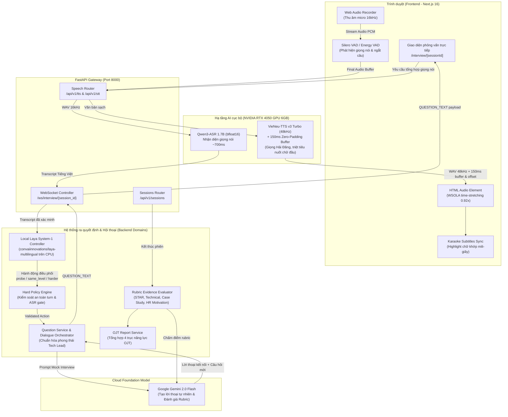

# CÓC ĐI LÀM — Nền Tảng Phỏng Vấn OJT Thực Chiến: Luyện phỏng vấn chuyên sâu bằng giọng nói kết hợp kiểm toán CV & JD Gap Analysis.

Ứng dụng gồm **một backend FastAPI** chia theo domain và một frontend Next.js. Các domain hiện chạy trong cùng process; cấu trúc folder chưa phải microservices.

## Các model thực sự được dùng

| Vai trò | Model/runtime | Chạy ở đâu | Cấu hình |
|---|---|---|---|
| Phát hiện bắt đầu/kết thúc nói | Silero VAD ONNX; energy VAD local khi ONNX chưa sẵn sàng | Browser | `frontend/public/models/silero_vad.onnx` |
| Chuyển lời nói thành chữ | Qwen3-ASR-1.7B | Backend local, CUDA | `STT_MODEL_PATH`, `STT_DEVICE` |
| Quyết định có nghe tiếp, hỏi lại, đổi độ khó, kết thúc | Laya Multilingual 322M | Backend local, CPU/RAM | `LAYA_MODEL_PATH`, `LAYA_DEVICE`, `LAYA_FAST` |
| Sinh lời thoại và câu hỏi theo CV/JD/khung | Gemini 3.5 Flash Lite | Google API | `GEMINI_FLASH_MODEL`, `GOOGLE_GEMINI_API_KEY` |
| Đọc lời phỏng vấn | VieNeu-TTS v3 Turbo | Backend local, mặc định CUDA | `VIENEU_MODEL_ID`, `VIENEU_VOICE`, `VIENEU_DEVICE` |
| Chấm rubric cuối phiên | Gemini 3.5 Flash Lite | Google API | `GEMINI_FLASH_MODEL` |

Các weight Qwen, VieNeu và Laya được tải/cache trên máy chạy backend. Câu hỏi và rubric gửi văn bản liên quan tới Gemini; âm thanh micro đi tới backend local. Luồng hiện tại không gọi ElevenLabs hay Web Speech Recognition.

## Kiến trúc hệ thống tổng thể (System Architecture)



1. Người dùng chọn CV; giao diện lấy chuyên môn và cấp độ từ CV mẫu hoặc hồ sơ CV đã tải lên để lọc các JD đã có khung. CV mẫu không có JD khớp bị ẩn khỏi danh sách. Không còn hai ô chọn chuyên môn/cấp độ riêng. Người dùng vẫn chọn **JD cụ thể** trong danh sách đã lọc, vì yêu cầu tuyển dụng và công ty không nằm trong CV. JD đã chọn quyết định khung phỏng vấn; CV bổ sung bằng chứng cá nhân. CV không có chuyên môn/cấp độ rõ hoặc không có JD khớp sẽ không được tự ghép JD khác ngành/cấp độ.
2. `candidate` chuẩn hóa CV/JD; `interview` nhận blueprint chứa kỹ năng, giai đoạn và tiêu chí rubric của khung. Gemini **viết câu mới** theo blueprint và lịch sử, không chép nguyên câu mẫu trong khung.
3. Khi vào phòng, browser tự xin quyền micro. Nếu Silero còn tải, energy VAD local vẫn tự phát hiện lời nói và chốt sau nhịp im lặng; không bắt ứng viên bấm tay. Browser gửi cửa sổ WAV tối đa 4,5 giây để có partial transcript; lượt partial đầu bắt đầu sau khoảng 1,5 giây giọng nói. Khi chốt, WAV được cắt bớt khoảng im lặng thừa rồi gửi tới Qwen3-ASR trên backend; file tạm được xóa sau nhận dạng.
4. Partial transcript qua WebSocket cho Laya xem để quyết định nghe tiếp, chờ ứng viên, ngắt mềm hoặc hỏi lại. Hard Policy kiểm tra action hợp lệ. Nếu final transcript chưa rõ, orchestrator nhờ Gemini viết **một câu hỏi lại có ngữ cảnh**, VieNeu đọc câu đó và micro tự mở lại. Hai lần nhận dạng độc lập khớp nhau mới tự chốt câu trả lời; không có nút xác nhận transcript bắt buộc.
5. Sau câu đã xác nhận, Laya chọn hướng câu tiếp theo; Gemini tạo lời hỏi từ CV/JD/khung/câu vừa nói. VieNeu tạo WAV; browser bắt đầu hiện lời theo tiến độ audio. **VieNeu chưa có timestamp phoneme**, nên mốc chữ hiện là ước lượng tuyến tính, chưa phải forced alignment chính xác.
6. Rubric chỉ chạy khi buổi phỏng vấn kết thúc. Nếu Gemini lỗi, report ở trạng thái chờ đánh giá; không dùng điểm tạm làm điểm thật.

## Cấu trúc chính

```text
backend/app/main.py                  Một FastAPI, ghép router/lifecycle
backend/app/domains/candidate/       Đọc CV/JD và tạo ngữ cảnh ứng viên
backend/app/domains/interview/       Blueprint, khung, Laya, WebSocket, Gemini, rubric
backend/app/domains/speech/api.py    VieNeu TTS và Qwen3-ASR local
backend/app/shared/                 Settings, contracts, storage, log/trace
frontend/src/app/interview/         Chọn CV/JD và phòng phỏng vấn
frontend/src/lib/edgeRuntime.ts     Thu WAV, gọi STT/TTS và phát audio
frontend/src/workers/vad.worker.ts  Silero VAD trong browser
data/normalized/                    candidates_clean.json, jobs_below_mid_clean.json,
                                    interview_frameworks_clean.json
docs/                               Tài liệu kiến trúc, JSON schemas, báo cáo benchmark
tools/                              Công cụ benchmark, kiểm tra thủ công và admin
```

Ranh giới domain và quy tắc import ở [backend/app/domains/README.md](backend/app/domains/README.md). Debug luồng local tại `http://127.0.0.1:3000/debug`; backend health ở `http://127.0.0.1:8000/health`.

## Cấu hình giọng và hiệu năng

Sao chép `backend/.env.example` thành `backend/.env`, rồi chỉnh các biến:

```dotenv
TTS_PROVIDER=vieneu
VIENEU_MODEL_ID=vieneu-v3-turbo
VIENEU_VOICE=Hải Đăng
VIENEU_DEVICE=cuda
VIENEU_MAX_BATCH_SIZE=32
VIENEU_MAX_STREAMS=16
VIENEU_TEMPERATURE=0.8
VIENEU_TOP_K=25
VIENEU_TOP_P=0.95
STT_MODEL_ID=Qwen3-ASR-1.7B
STT_MODEL_PATH=Qwen/Qwen3-ASR-1.7B
STT_DEVICE=cuda
LAYA_MODEL_PATH=convaiinnovations/laya-multilingual
LAYA_DEVICE=cpu
LAYA_FAST=false
GEMINI_FLASH_MODEL=gemini-3.5-flash-lite
```

`VIENEU_VOICE` là tên preset, ví dụ `Hải Đăng`, `Mai Anh`, `Trúc Ly`. Backend trả danh sách tại `/api/v1/tts/voices`. Mặc định chỉ Qwen3-ASR và VieNeu được nạp lên CUDA/VRAM; Laya dùng CPU/RAM (`LAYA_DEVICE=cpu`, `LAYA_FAST=false`). Nếu máy không có CUDA, cần chủ động đổi `STT_DEVICE` và `VIENEU_DEVICE` sang `cpu` trước khi chạy. `/health` trả thiết bị thực tế của các model.

## Chạy và kiểm thử

Trên Windows, chạy `start.bat`; `stop.bat` dừng launcher. Có thể dùng `python dev_runner.py status` để kiểm tra trạng thái. Frontend mặc định `http://127.0.0.1:3000`, backend `http://127.0.0.1:8000`.

```powershell
python -m pytest backend/tests -q
cd frontend
npm test
npm run build
```

Kiểm tra model local bằng `python tools/preflight_local_models.py`. Benchmark đầy đủ hai phiên 8 lượt với **Gemini API thật** chạy bằng `python tools/benchmarks/benchmark_interview_local_two_runs.py --live --runs 2`; script sinh lời ứng viên bằng VieNeu, cho Qwen nghe WAV, gửi transcript qua WebSocket, để Gemini/Laya điều phối và chấm cuối phiên. Kịch bản này kiểm tra backend/audio API; thử micro, Silero và phát audio trong browser cần chạy UI tương tác riêng.
